# Отчет по домашнему заданию занятия "Установка PostgreSQL"


## 1. Скачал образ
С помощью команды ```docker pull postgres:18``` скачал докер-образ PostgreSQL 18-ой версии и с помощью команды ```docker images``` проверил успешность операции.

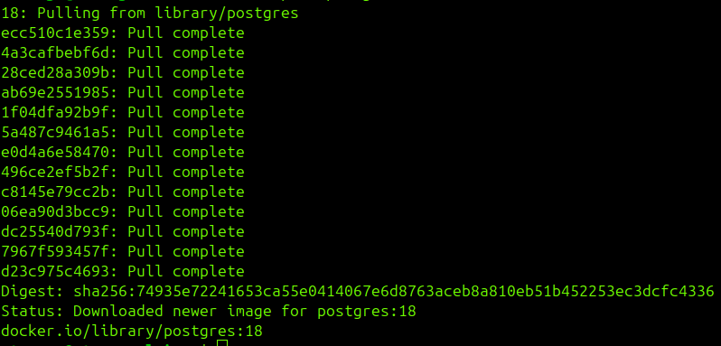

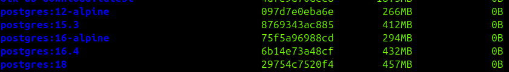


## 2. Создал директорию для монтирования вольюма
С помощью команды ```sudo mkdir -p /var/lib/pg_docker``` создал директорию, в которую буду монтировать вольюм для хранения данных базы между перезапусками контейнера. Расшифровка: 
- sudo (Superuser Do - "выполнить команду с правами администратора"): — запускает команду с правами администратора (суперпользователя root). Это необходимо, так как обычным пользователям запрещено изменять содержимое системного каталога /var.
- mkdir — сокращение от make directory (создать директорию/папку). Это стандартная утилита Linux для создания новых папок.
- -p — флаг parents (родители). Очень полезный параметр, который делает две вещи:
	1. Создает все недостающие родительские папки в цепочке (например, если папки /var/lib вдруг не существовало, команда создаст и её, и pg_docker).
	2. Не выдает ошибку, если папка /var/lib/pg_docker уже существует (команда просто успешно завершится, ничего не перезаписывая).
- /var/lib/pg_docker — абсолютный путь к создаваемой папке. Она создается для хранения данных базы данных PostgreSQL, работающей внутри Docker-контейнера.

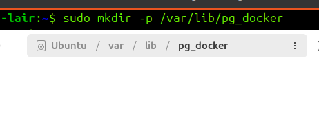


## 3. Работа с базой через psql
1) Запустил контейнер, указав нужные параметры имени, переменных окружения, порта, вольюма и исходного образа.
2) Запустил командную оболочку Bash внутри контейнера.
3) Уточнил под кем я через ```whoamy``` (Ведь root перед @ было недостаточно... Есть ещё альтернативный способ - посмотреть значение переменной окружения: ```echo $USER``` - выведет имя пользователя, сохраненное в настройках текущей сессии. А для большей детализации можно ввести команду ```id```).
4) Осмотрелся через ```ls```.
5) Проник внутрь var/lib с помощью ```cd``` и снова осмотрелся.
6) Дошёл до конечной точки маршрута по пути postgresql/18/docker осмотрелся последний раз и окончательно убедился, что я там, где нужно.
7) С помощью команды ```su``` ("Substitute User", сменить пользователя - эта команда позволяет временно переключиться на учетную запись другого пользователя прямо в текущем сеансе терминала) сменил своего пользователя на "postgres". (С параметрами команда переключает на указанного пользователя, а без параметров пытается переключить на root, главного администратора системы. Только к успеху это не приведет, так как, по умолчанию, учетная запись root заблокирована и не имеет пароля, но можно использовать sudo и ввести свой пароль, для разового исполнения команды с правами администратора. Или если всё-таки нужно открыть полноценную терминальную сессию под пользователем root, можно ввести sudo su или sudo -i, введя свой пароль).
8) Запустил ```psql```.
9) С помощью команды ```CREATE DATABASE my_first_test_database``` попытался создать первую (не техническую) базу данных, но после команды ```\list``` увидел, что она не создалась. Понял, что дело было в том, что я забыл ";" в конце, так как даже успешно введенная команда тоже привела к ошибке (так как до появления ";") для системы это всё выглядело как какая-то галиматья. Но в этот момент "проклятье" и было снято, так как ";" утилита по итогу увидела и посчитала это концом неправильной команды. Ещё это можно было понять по изменившемуся "приглашению": если "=#" говорит о том, что ожидает новый ввод, то "-#" говорило о том, что ожидает продолжение ввода команды. Также это состояние можно было сбросить вводом ```Ctrl + C```. Это бы очистило буфер и прервало ввод незавершенной команды.
10) После успешного ввода команды создания базы я увидел её в списке, вызванном через \list. Кстати, вместо \list ещё можно было сделать так: ```SELECT datname FROM pg_database;```
11) Далее с помощью команды ```\dt *``` (display tables) я посмотрел все имеющиеся в базе таблицы. Также полезно знать и другие модификации этой команды:
- ```\dt+``` — покажет расширенную информацию (дополнительно выведет размер таблиц на диске и их описание/комментарии).
- ```\d имя_таблицы``` — покажет структуру конкретной таблицы (список колонок, их типы данных, индексы и внешние ключи).
- ```\dt *``` — покажет вообще все таблицы во всех схемах (включая системные).
12) Далее я попытался создать первую таблицу. И это были мои вторые "грабли", так как я не передал параметры и получил ошибку. Правильным вариантом было:
```
CREATE TABLE my_first_relation (
    id SERIAL PRIMARY KEY,
    name VARCHAR(30),
    description TEXT,
    isTrue BOOLEAN
);
```
13) Посмотрел на результат через ```\d my_first_relation```.
14) Не понравилось, что поле "istrue" создалось в одном регистре - нижнем. Но это был мой косяк. Кажется его нужно было обернуть в двойные кавычки, на сколько я помню, если бы я хотел сохранить регистр. Но это бы всё равно было неправильно, так как согласованный нейминг для именования таблиц - это нижний snake_case.
15) Потому я решил это исправить: ```ALTER TABLE my_first_relation RENAME COLUMN istrue TO is_true;```.
16) После этого я вставил в новую таблицу первую запись: ```INSERT INTO my_first_relation VALUES (1, 'pipka', 'WTF pipka?', true);```.
17) И убедился, что всё получилось: ```SELECT * FROM my_first_relation;```.
18) После этого сделал трёхкратный ```exit```, последовательно выйдя из базы, из под пользователя postgres и из контейнера. А затем остановил контейнер: ```docker stop my-test-posgres-18```. Так как он был запущен с флагом ```--rm```, то после остановки сразу был уничтожен и командой ```docker ps -a``` также не отображался.


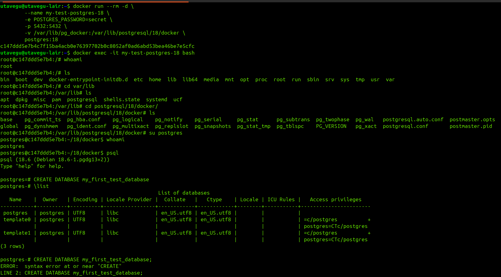

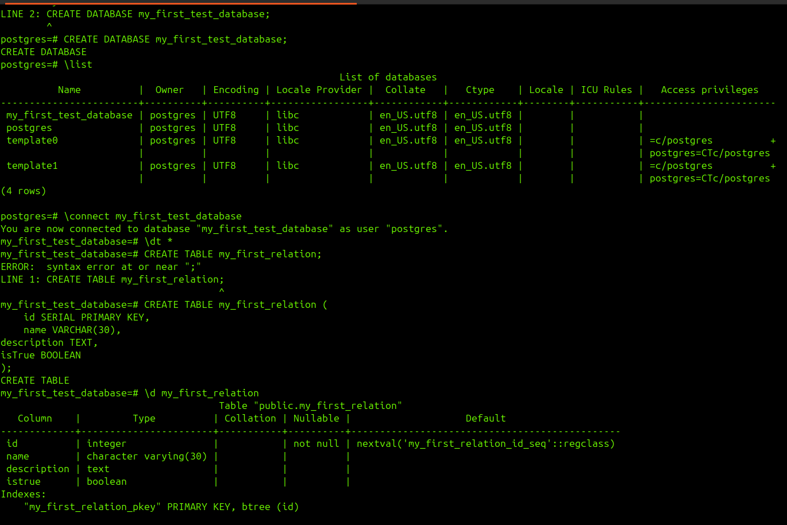

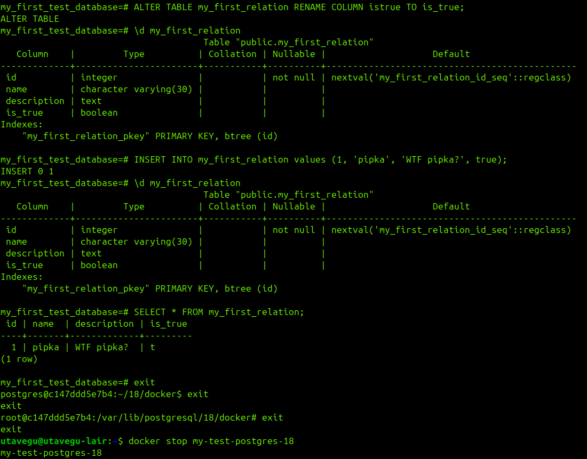


## 4. Проверка, что примонтированная к вольюму директория заполнилась
Перед тем, как потушить контейнер, я проверил связанную через вольюм директорию, что в ней есть данные и я их не потеряю, после уничтожения контейнера.

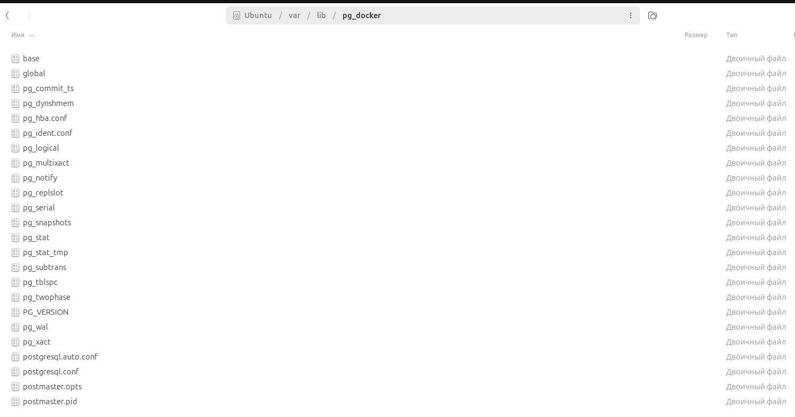


## 5. Работа с базой через DBeaver
Также, до того как остановить контейнер, я успел подключиться к нему (и к этой же базе) через DBeaver. Проверил через него ранее созданную таблицу и его данные, а также, через его интерфейс, создал ещё одну запись в таблице.

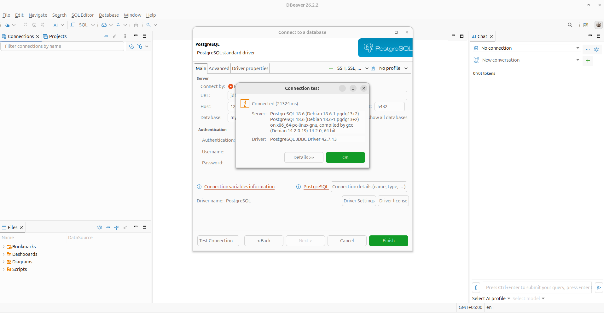

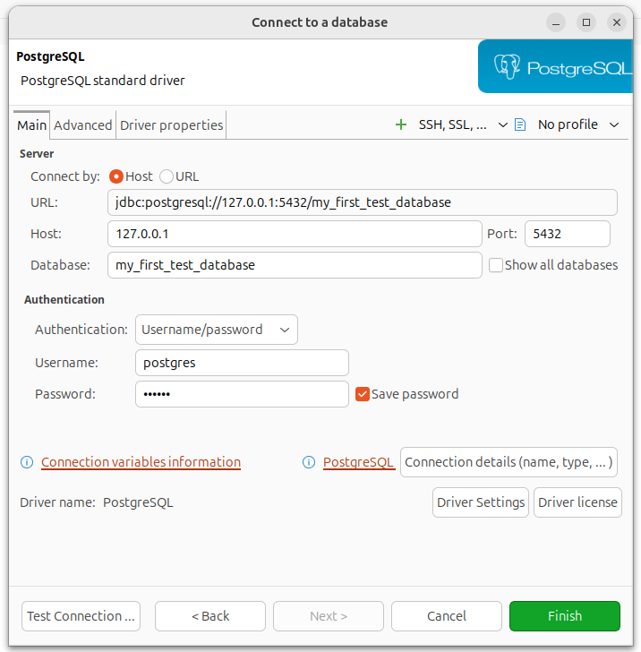

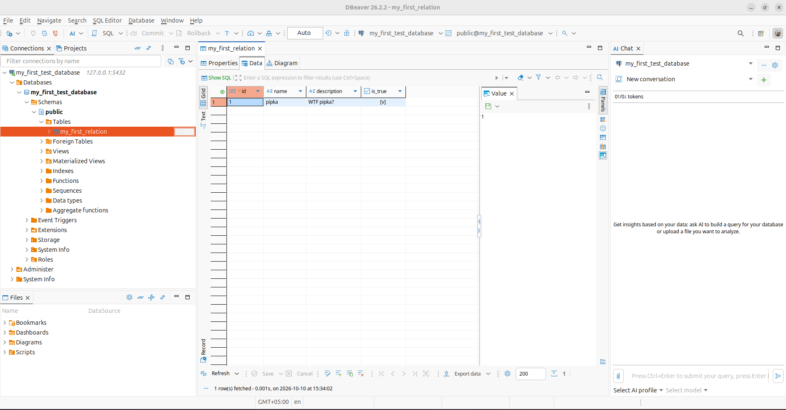

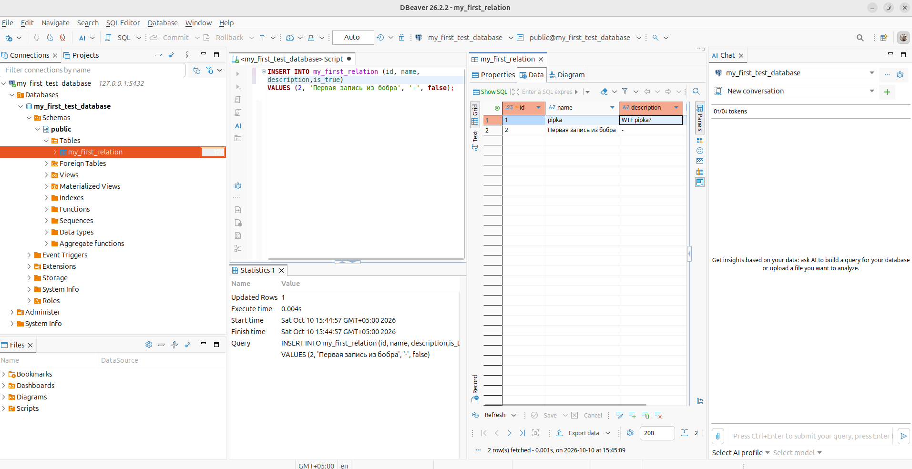


## 6. Настройка окружения (Подзаголовок)
После остановки контейнера я создал новый контейнер с теми же параметрами запуска и повторил шаги из блока 3, чтобы присоединиться к базе и сделать запрос на выборку всех данных из целевой таблицы. Я убедился, что данные целы, а запись, которую я создавал через DBeaver - также присутствует в таблице.

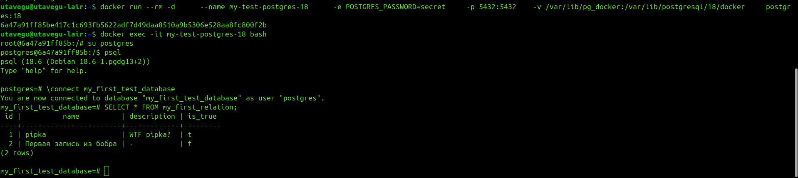
