# Домашнее задание: Перенос каталога данных PostgreSQL на дополнительный диск

## 1. Установка Oracle VirtualBox
Для работы с виртуальными машинами я установил Oracle VirtualBox. Был выбран официальный репозиторий Oracle, так как встроенный в Ubuntu 24.04 пакет VirtualBox 7.0.16 имеет известную несовместимость с новым ядром 7.0.0-38 (HWE). Ubuntu пока не выпустила исправление, и dkms не может собрать модуль ядра. Единственное рабочее решение — перейти на официальную версию VirtualBox 7.2 от Oracle, где эта проблема уже исправлена.

```bash
sudo apt install -y curl gnupg
curl -fsSL https://www.virtualbox.org/download/oracle_vbox_2016.asc | sudo gpg --dearmor -o /usr/share/keyrings/oracle-virtualbox-2016.gpg
echo "deb [arch=amd64 signed-by=/usr/share/keyrings/oracle-virtualbox-2016.gpg] https://download.virtualbox.org/virtualbox/debian noble contrib" | sudo tee /etc/apt/sources.list.d/virtualbox.list
sudo apt update
sudo apt install -y virtualbox-7.2
```
> **Разбор команд:**
> * curl — утилита для передачи данных по сети (скачивание ключа).
> * gpg --dearmor — конвертация ключа в бинарный формат для apt.
> * echo ... | sudo tee — вывод текста и запись его в файл с правами суперпользователя.
> * apt update — обновление локального индекса пакетов из подключенных репозиториев.

Проверяю, что VirtualBox установился, а модуль ядра загрузился:

```bash
vboxmanage -v
lsmod | grep vboxdrv
```

> **Разбор команд:**
> * lsmod — показывает список загруженных модулей ядра.
> * grep vboxdrv — фильтрует вывод, оставляя только строки с названием модуля VirtualBox.

## 2. Скачивание ISO-образа
Скачал образ ubuntu-24.04.5-live-server-amd64.iso с официального сайта https://ubuntu.com/download/server.

## 3. Создание виртуальной машины
Создал ВМ pg-hw02 через GUI Oracle VirtualBox (параметры: 4 ГБ RAM, 2 CPU, 25 ГБ диск).

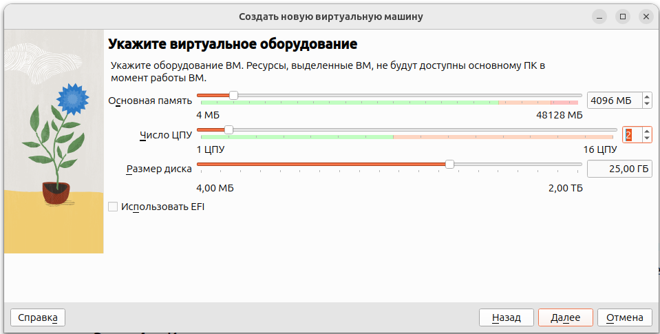
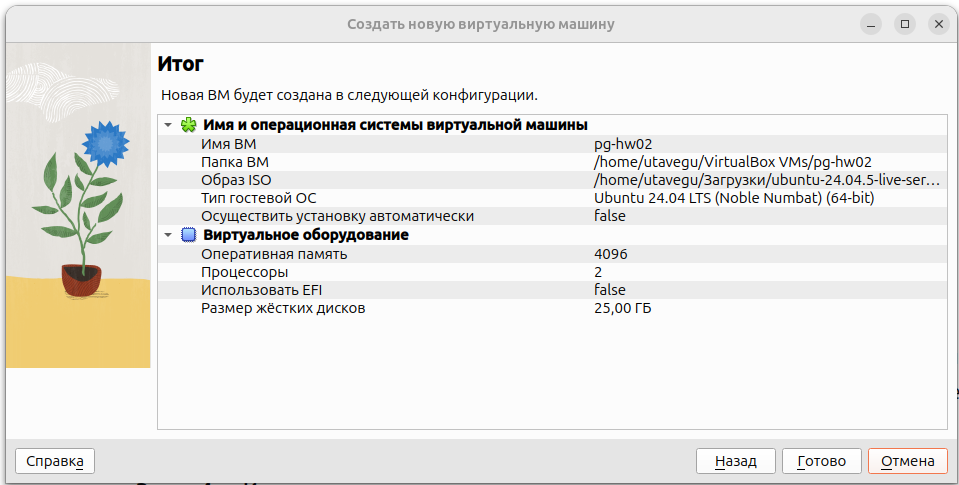


## 4. Настройка BIOS хоста
При первой попытке запуска ВМ возникла ошибка:
AMD-V is disabled in the BIOS (or by the host OS) (VERR_SVM_DISABLED).
Чтобы её устранить, пришлось перезагрузить физическую машину и внести изменения в BIOS. Я выставил параметр SVM (Secure Virtual Machine) в положение Enabled, после чего виртуальная машина успешно запустилась.

## 5. Установка Ubuntu на ВМ
В процессе установки я выбрал установку OpenSSH server. Это необходимо для того, чтобы впоследствии иметь возможность подключаться к ВМ по SSH из терминала основной ОС.

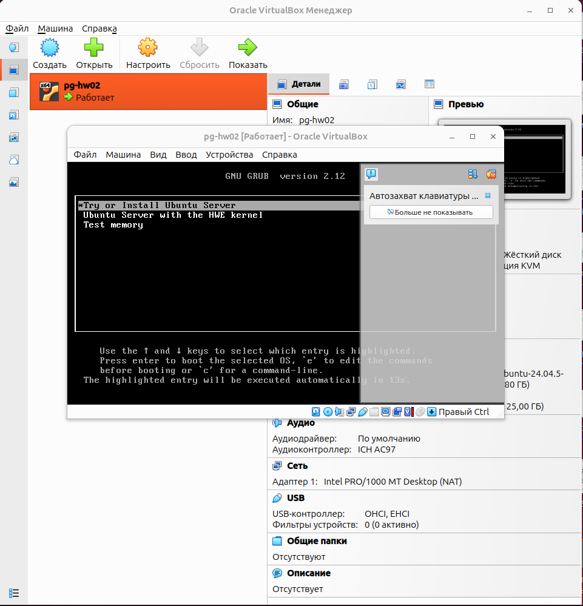
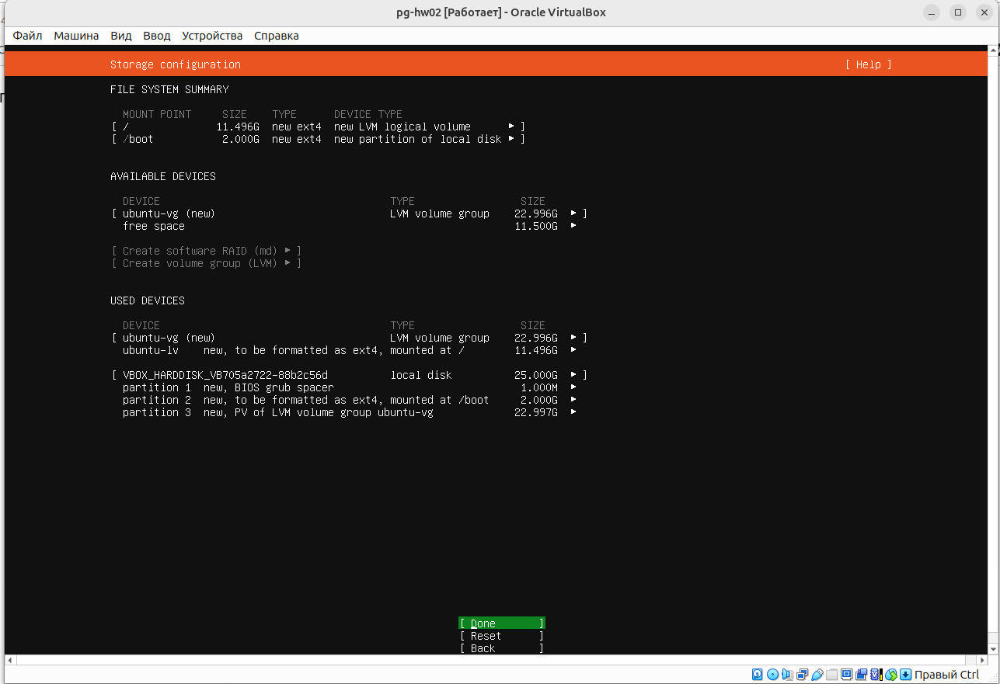
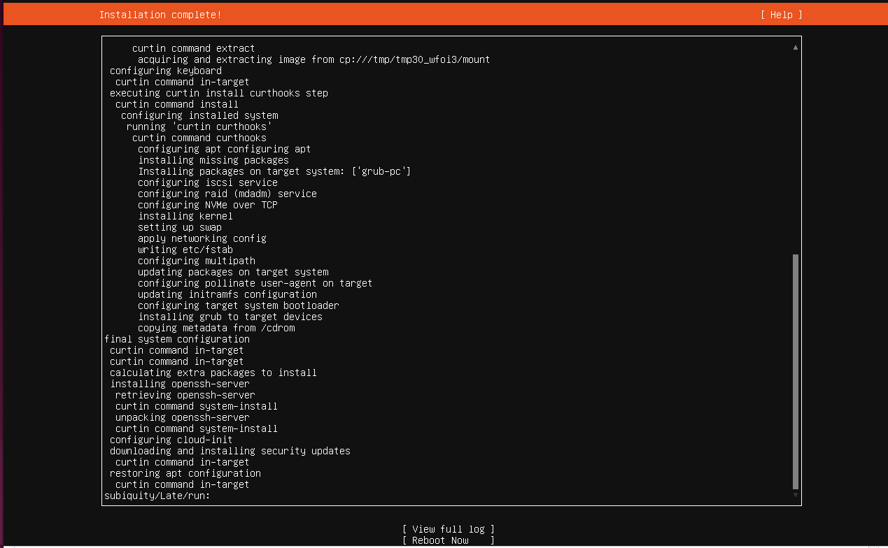
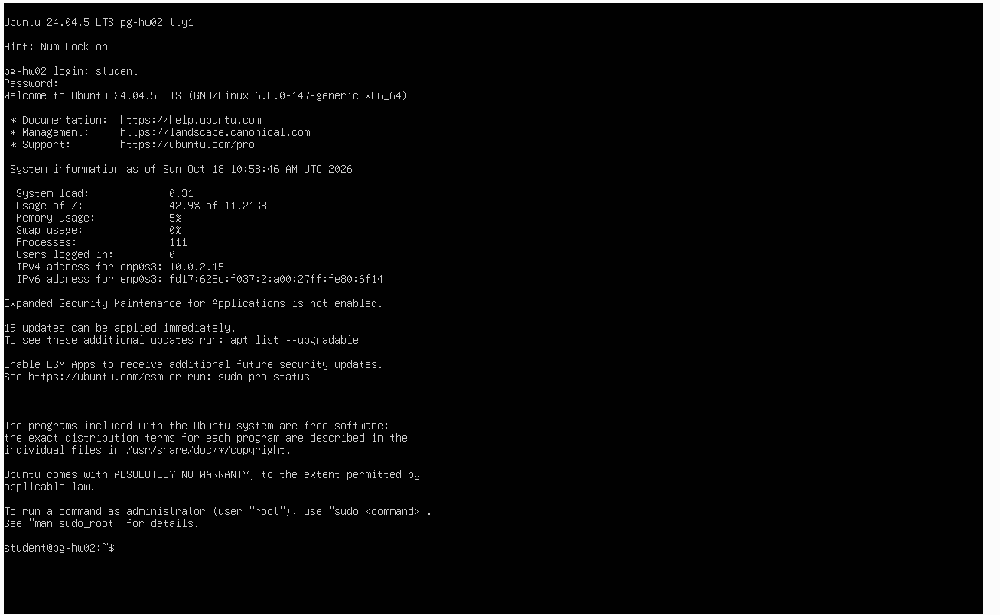

## 6. Настройка сети для доступа по SSH
В настройках GUI VirtualBox (раздел «Сеть» -> «Проброс портов») я настроил проброс порта 2222 с хоста на порт 22 гостевой ВМ. Теперь я могу подключаться к ВМ из терминала основной Ubuntu командой ssh student@127.0.0.1 -p 2222.

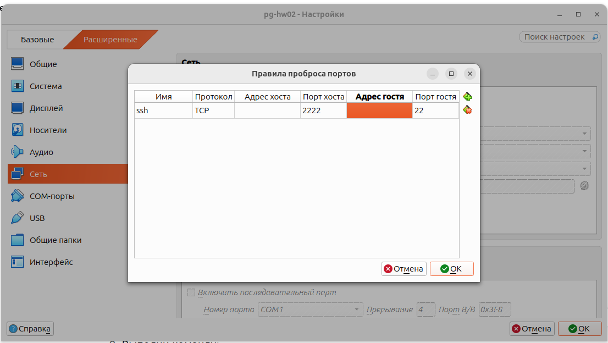
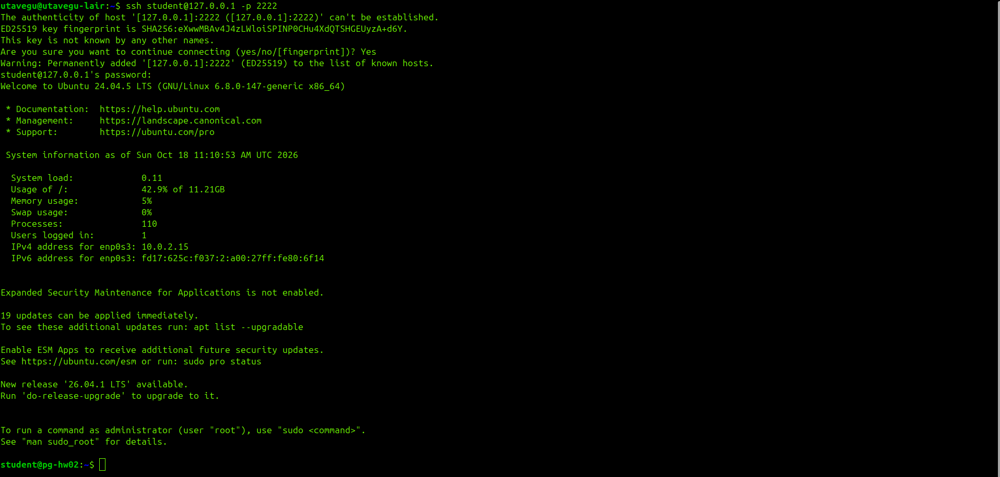

## 7. Установка PostgreSQL
Обновил список пакетов (`apt update`). Установил сам PostgreSQL и пакет postgresql-contrib.
postgresql-contrib — это набор дополнительных утилит и расширений (например, для мониторинга pg_stat_statements, шифрования pgcrypto), которые часто необходимы администраторам баз данных.

```bash
sudo apt update
sudo apt install -y postgresql postgresql-contrib
```

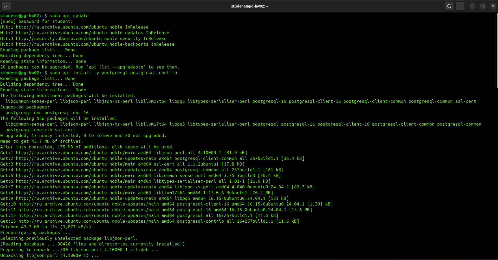
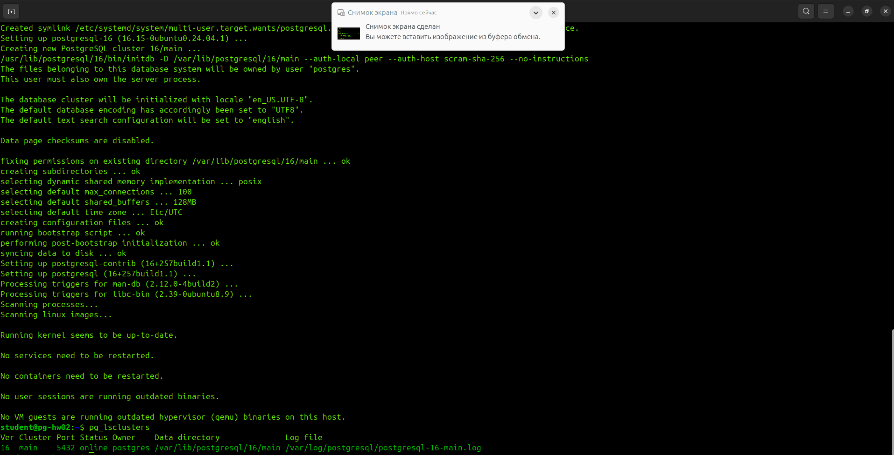

## 8. Проверка кластера, создание таблицы и тестовых данных
Проверил статус кластера с помощью команды `pg_lsclusters`.
С помощью команды `sudo -u postgres psql` запустил утилиту psql от имени системного пользователя postgres (обладая правами администратора sudo). Это нужно, так как внутри самой СУБД пользователя student по умолчанию не существует.
Внутри psql я создал таблицу, вставил 2 строки, проверил их наличие и запросил путь к каталогу данных. А затем вышел из psql с помощью команды `\q`.

```bash
pg_lsclusters
sudo -u postgres psql
```

(Внутри psql):
```sql
CREATE TABLE test (id integer, name text);
INSERT INTO test VALUES (1, 'first'), (2, 'second');
SELECT * FROM test;
SHOW data_directory;
\q
```

> **Разбор команд:**
> * pg_lsclusters — утилита Debian/Ubuntu для просмотра списка кластеров PostgreSQL, их версий, портов и статуса.
> * sudo -u postgres psql — выполнить (sudo) команду psql от имени пользователя (-u) postgres.

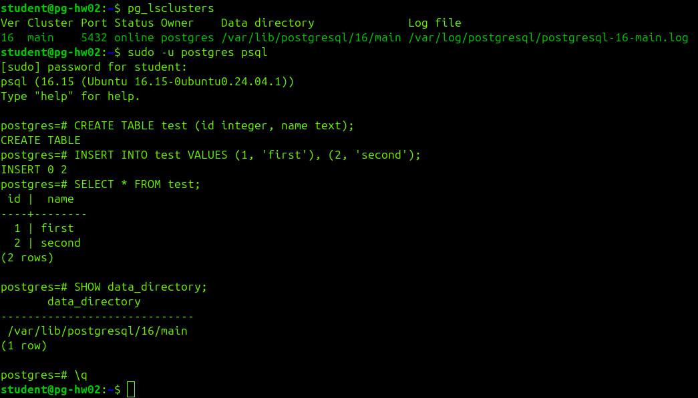

## 9. Остановка кластера и ВМ
Корректно остановил кластер, проверил его статус и выключил виртуальную машину.

```bash
sudo pg_ctlcluster 16 main stop
pg_lsclusters
sudo poweroff
```

> **Разбор команд:**
> * pg_ctlcluster 16 main stop — управление кластером: версия 16, имя main, действие stop.
> * poweroff — безопасное выключение питания (отправляет сигналы завершения всем процессам).

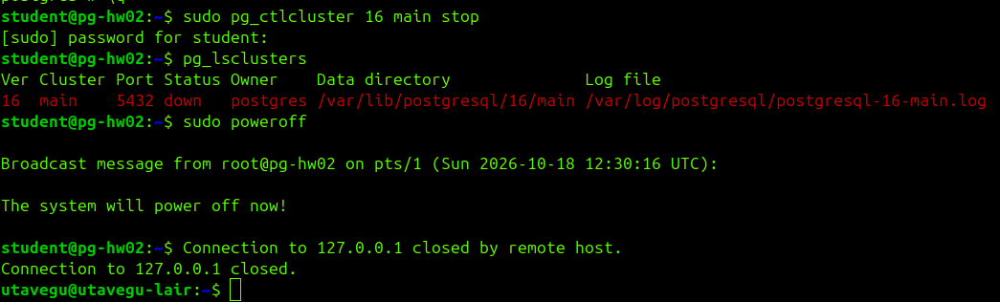

## 10. Добавление нового диска
Вернулся в GUI VirtualBox, добавил к контроллеру SATA новый виртуальный жесткий диск объемом 10 ГБ.

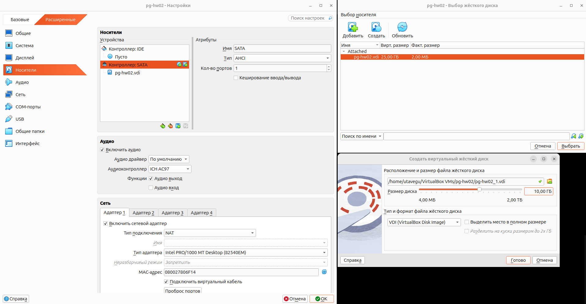
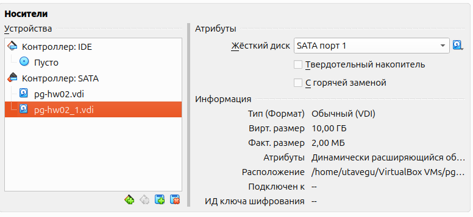

## 11. Разметка диска и создание файловой системы
Запустил ВМ, подключился по SSH. Проверил, что новый диск sdb виден системе.
Разметил его: создал таблицу разделов GPT и один раздел на всё свободное пространство. Затем отформатировал раздел в файловую систему ext4 (стандартная, стабильная журналируемая ФС для Linux, оптимальная для баз данных). Создал точку монтирования и примонтировал диск.

```bash
lsblk
sudo parted -s /dev/sdb mklabel gpt
sudo parted -s /dev/sdb mkpart primary ext4 0% 100%
lsblk
sudo mkfs.ext4 /dev/sdb1
sudo mkdir -p /mnt/data
sudo mount /dev/sdb1 /mnt/data
df -h /mnt/data
```

> **Разбор команд:**
> * lsblk — утилита для отображения информации о блочных устройствах (дисках и разделах).
> * parted -s — утилита для работы с разделами. Флаг -s (script) отключает интерактивные запросы. mklabel gpt создает таблицу разделов GPT. mkpart создает раздел.
> * mkfs.ext4 — (Make File System) создание файловой системы ext4 на разделе /dev/sdb1.
> * mkdir -p — создает директорию. Флаг -p (parents) создает все недостающие родительские директории и не выдает ошибку, если директория уже существует.
> * mount — присоединяет файловую систему раздела к дереву каталогов Linux в точку /mnt/data.
> * df -h — (Disk Free) показывает свободное место. Флаг -h (human-readable) выводит размеры в ГБ/МБ, а не в байтах.

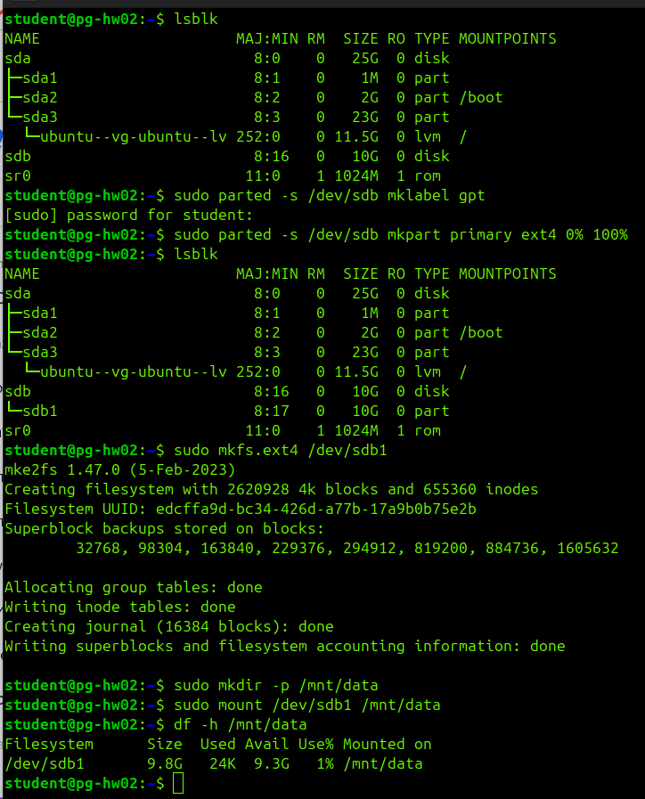

## 12. Автомонтирование (fstab) и проверка
Для того чтобы диск монтировался автоматически при загрузке, я добавил запись в файл /etc/fstab. Сначала с помощью `blkid` узнал UUID раздела (уникальный идентификатор, который не меняется, в отличие от имен вида /dev/sdb1). Затем добавил запись в fstab, применил настройки командой `mount -a` и перезагрузил систему. После этого меня выкинуло из виртуальной машины, а прогресс перезагрузки я отслеживал через GUI запущенного инстанса ВМ.
После перезагрузки снова подключился по SSH и проверил, что диск на месте.

```bash
sudo blkid /dev/sdb1
sudo nano /etc/fstab
cat /etc/fstab
sudo mount -a
sudo reboot
df -h /mnt/data
```

> **Разбор команд:**
> * blkid — показывает UUID, метки и типы файловых систем блочных устройств.
> * cat — выводит содержимое файла в терминал.
> * mount -a — монтирует все файловые системы, указанные в /etc/fstab, которые еще не смонтированы. Используется для проверки правильности конфигурации без перезагрузки.
> * reboot — перезагрузка системы.

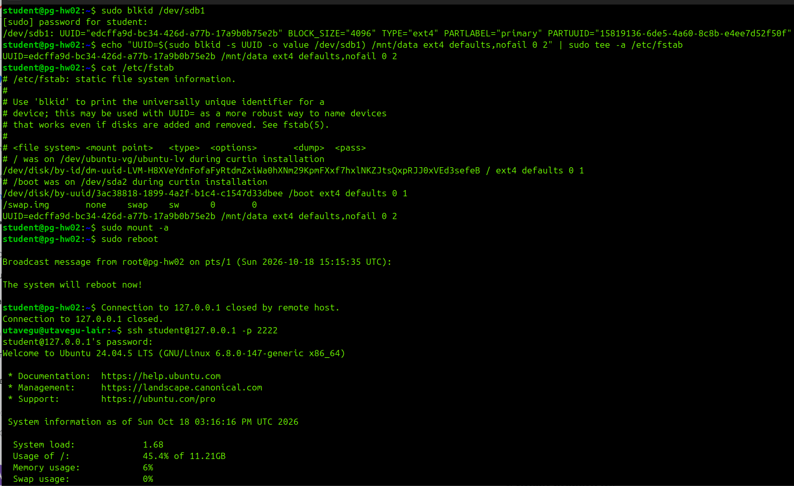
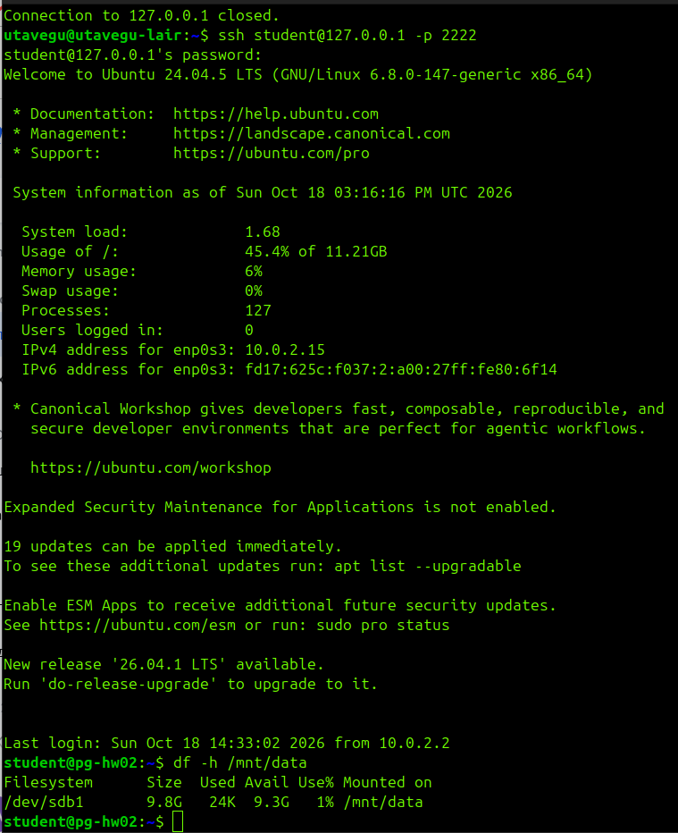

## 13. Перенос данных и фиксация ошибки
Остановил кластер. Изменил владельца директории /mnt/data на пользователя postgres (это критически важно, так как процессы PostgreSQL запускаются от этого пользователя и должны иметь права на чтение/запись). Переместил каталог с данными на новый диск. Убедился, что права сохранились.
Попытался запустить кластер и ожидаемо получил ошибку. С помощью `tail` посмотрел последние строки лога, чтобы зафиксировать причину.

```bash
sudo pg_ctlcluster 16 main stop
sudo chown postgres:postgres /mnt/data
ls -ld /mnt/data
sudo mv /var/lib/postgresql/16/main /mnt/data/main
sudo ls -la /mnt/data/main | head -n 5
sudo pg_ctlcluster 16 main start
sudo tail -n 20 /var/log/postgresql/postgresql-16-main.log
```

> **Разбор команд:**
> * chown postgres:postgres — (Change Owner) меняет владельца и группу файла/директории.
> * ls -ld — показывает информацию о самой директории (флаг -d), а не о её содержимом, в длинном формате (-l).
> * mv — перемещение или переименование файлов и директорий.
> * head -n 5 — выводит первые 5 строк ввода (используется здесь в связке с pipe | для просмотра только начала списка файлов).
> * tail -n 20 — выводит последние 20 строк файла (лога), что позволяет увидеть свежие ошибки.

Ошибка: Error: /var/lib/postgresql/16/main is not accessible or does not exist. Причина в том, что pg_ctlcluster при запуске читает путь к данным из конфигурационного файла, где все еще указан старый путь.

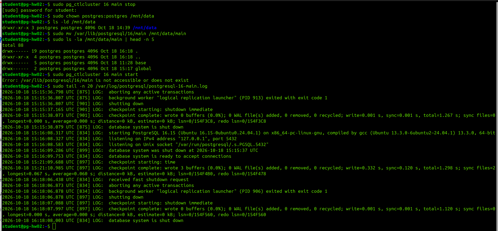

## 14. Изменение параметра data_directory и итоговая проверка
Нашел строку с параметром data_directory в конфигурационном файле с помощью `grep`. Попытался заменить путь автоматически через `sed`, но команда не сработала, так как в строке не было символа # (строка уже была раскомментирована), а регулярное выражение искало именно с ним. Я открыл файл через текстовый редактор nano и заменил путь вручную.
Успешно запустил кластер, проверил его статус и выполнил тестовый запрос к таблице test для подтверждения целостности данных.

```bash
grep -n "data_directory" /etc/postgresql/16/main/postgresql.conf
sudo sed -i "s|#data_directory = '/var/lib/postgresql/16/main'|data_directory = '/mnt/data/main'|g" /etc/postgresql/16/main/postgresql.conf
grep -n "data_directory" /etc/postgresql/16/main/postgresql.conf
sudo nano /etc/postgresql/16/main/postgresql.conf
# (меняем строку на data_directory = '/mnt/data/main')
grep -n "data_directory" /etc/postgresql/16/main/postgresql.conf
sudo pg_ctlcluster 16 main start
pg_lsclusters
sudo -u postgres psql -c "SELECT * FROM test;"
sudo -u postgres psql -c "SHOW data_directory;"
```

> **Разбор команд:**
> * grep -n — поиск текста в файле. Флаг -n (number) выводит номер строки, где найдено совпадение.
> * sed -i — потоковый редактор. Флаг -i (in-place) позволяет редактировать файл на месте, без сохранения в новый. Синтаксис s|old|new|g означает замену всех (g - global) вхождений old на new.
> * nano — простой консольный текстовый редактор.
> * psql -c "SQL" — выполнить одну SQL-команду (-c - command) и выйти.

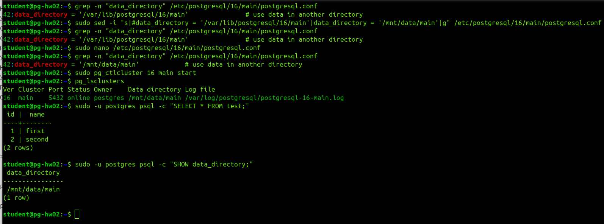

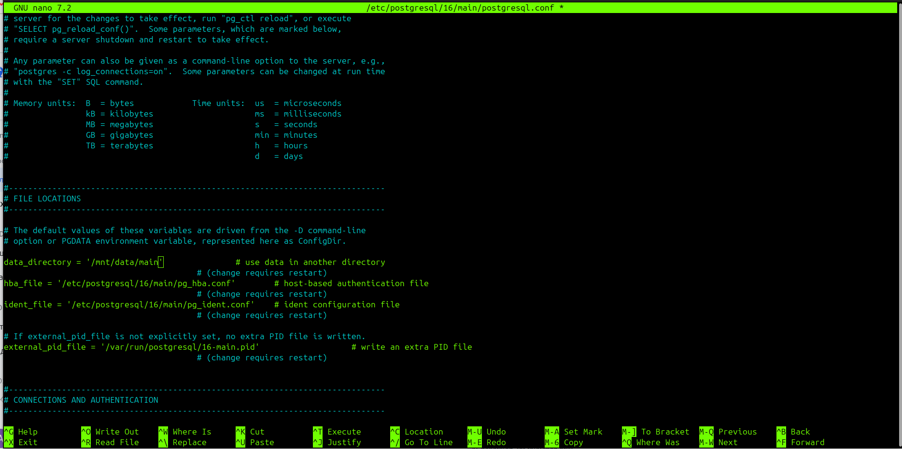

Вывод: Все данные на месте (2 строки в таблице test), база успешно работает с нового диска. Этот результат соответствует моим ожиданиям.