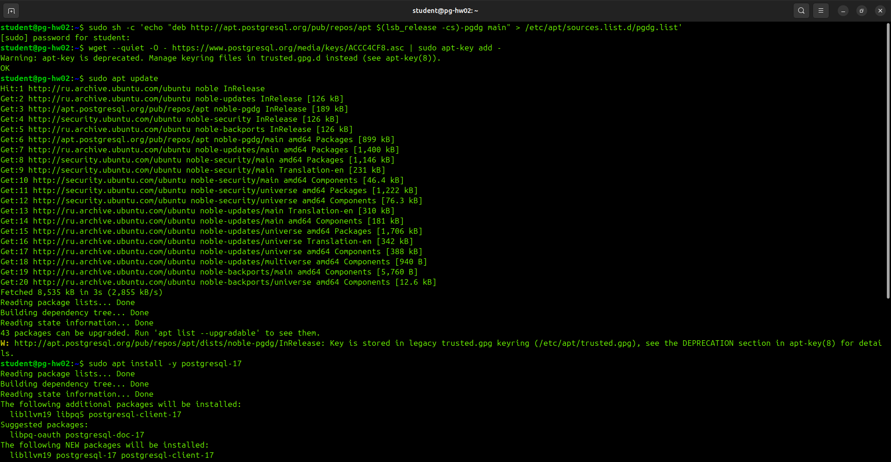
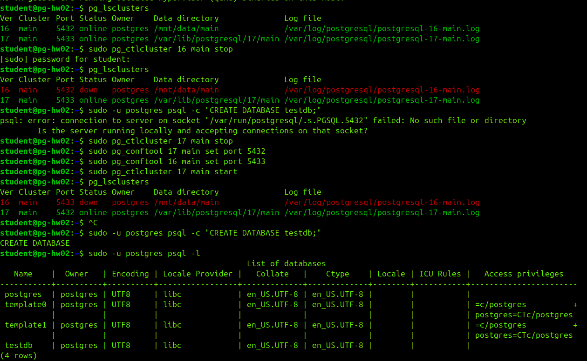
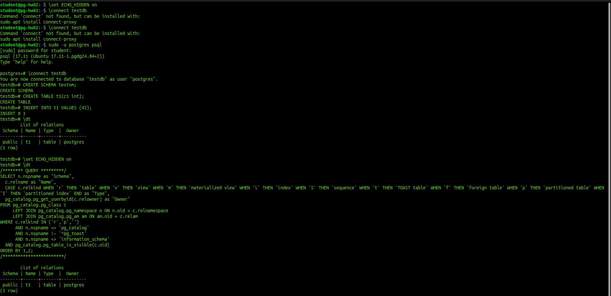
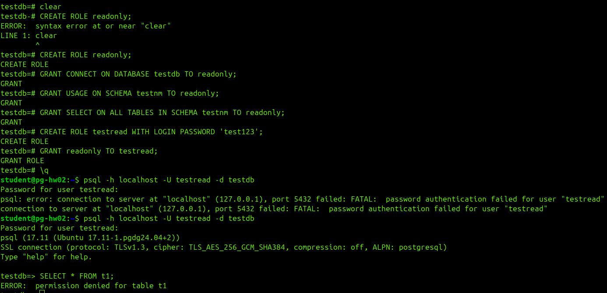
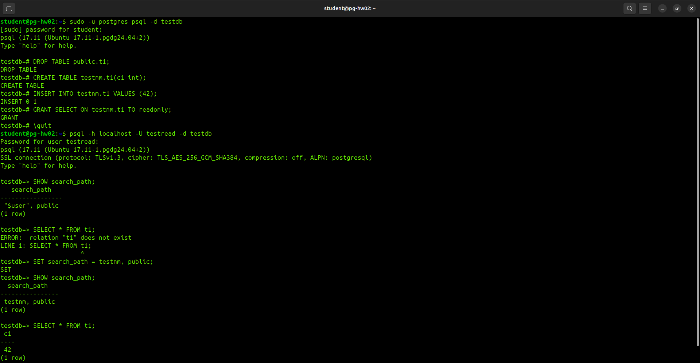
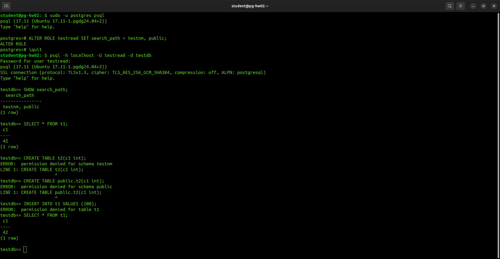

# Домашнее задание блока "Логический уровень PostgreSQL"
Для выполнения домашнего задания я решил использовать виртуальную машину, созданную в предыдущем задании. Но там нужно было использовать PostgreSQL 16, а в этом задании явно указана 17 версия. Потому нужно установить её. Добавляю официальный репозиторий PGDG:
```
sudo sh -c 'echo "deb http://apt.postgresql.org/pub/repos/apt $(lsb_release -cs)-pgdg main" > /etc/apt/sources.list.d/pgdg.list'
wget --quiet -O - https://www.postgresql.org/media/keys/ACCC4CF8.asc | sudo apt-key add -
```

Расшифрока команд (для понимания работы пакетных менеджеров в Linux):

- `echo "deb ..." > /etc/apt/sources.list.d/pgdg.list` - добавляю новый "адрес" (репозиторий) в список источников apt. В стандартных репозиториях Ubuntu (по умолчанию) версия PostgreSQL может быть старой (например, 16-я). Официальный репозиторий PGDG (PostgreSQL Global Development Group) содержит самые свежие версии. То есть говорю системе: «когда будешь искать пакеты, загляни ещё и сюда».

- `wget ... | sudo apt-key add -` - добавил цифровой GPG-ключ. Это нужно для безопасности. Когда apt скачивает пакет из интернета, он проверяет его цифровую подпись этим ключом. Если пакет был подменён злоумышленником (например, взломан сервер), подпись не сойдётся, и apt откажется его устанавливать.

Обновляю индексы и ставлю PostgreSQL 17:
```
sudo apt update
sudo apt install -y postgresql-17
```



После успешной установки PostgreSQL смотрю, какие кластеры теперь есть:
```pg_lsclusters```

Останавливаю 16-й кластер, чтобы освободить 5432 порт для 17-го:
``` bash
sudo pg_ctlcluster 16 main stop
pg_lsclusters
```

Попытался создать тестовую базу, но поймал ошибку, потому что по умолчанию psql стучится в порт 5432:
```
sudo -u postgres psql -c "CREATE DATABASE testdb;"
```
psql: error: connection to server on socket "/var/run/postgresql/.s.PGSQL.5432" failed: No such file or directory
	Is the server running locally and accepting connections on that socket?

Потому решил переназначить этот порт кластеру с posqtgresql 17,а 16-ой отдать 5433 порт, так как вряд ли я ещё буду с ней работать. В целом можно явно указывать порт для psql в каждой команде (`psql -p 5433`), но в рамках выполнения этого задания я решил пойти другим путём.

Останавливаю 17-й кластер, который висит на 5433: `sudo pg_ctlcluster 17 main stop`

Меняю ему порт в конфигурации на 5432: `sudo pg_conftool 17 main set port 5432`

А шеснадцатому - на 5433: `sudo pg_conftool 16 main set port 5433`

Запускаю обратно 17 кластер: `sudo pg_ctlcluster 17 main start`

Проверя., что всё встало на свои места: `pg_lsclusters`

Теперь нормально создал тестовую базу и посмотрел доступные базы данных:
```
sudo -u postgres psql -c "CREATE DATABASE testdb;"
sudo -u postgres psql -l
```



В учебных целях выставляю значение переменной ECHO_HIDDEN в on, чтобы понимать что "под капотом" делают метакоманды(какой SQL запрос генерирует и отправляет на сервер psql): `\set ECHO_HIDDEN on`
Также полезно будет помнить:
- Включить при старте: можно запускать psql с флагом -E (или --echo-hidden), тогда ECHO_HIDDEN будет включён сразу для всей сессии.
- Режим noexec: если установить \set ECHO_HIDDEN noexec, psql будет показывать сгенерированный SQL, но не будет отправлять его на выполнение. Это удобно, если ты хочешь просто посмотреть, как устроена команда, не получая её результат.
- Также важно помнить, что эта настройка не сохраняется между сессиями.

Пытаюсь подключиться к новой тестовой базе: `\connect testdb`, но до меня не сразу доходит, что я не внутри psql, потому ловлю ошибку.

Запускаю psql: `sudo -u postgres psql`. И после этого мне уже успешно удаётся подключиться к базе testdb.

Создаю схему testnm `CREATE SCHEMA testnm;`

Создаю таблицу БЕЗ указания схемы (для имитации ошибки): `CREATE TABLE t1(c1 int);`

Вставляю строку: `INSERT INTO t1 VALUES (42);`

Смотрию, где на самом деле оказалась таблица: `\dt`. Таблица t1 создалась в схеме public, хоть я и создал схему testnm. Так как я "забыл" указать схему, PostgreSQL положил таблицу туда, куда ему разрешил search_path по умолчанию.

Также после ввода этой команды я понял, что `\set ECHO_HIDDEN on` также не отработал, потому я ввёл его повторно и снова запросил список таблиц, чтобы увидеть SQL-скрипт, вызывающий его.



--------
## Список метакоманд утилиты psql, которые мне сегодня, скорее всего, пригодятся:
- \connect (или \c) - подключиться к базе данных.
- \dt (или \dt+) - список таблиц (с + - подробнее).
- \d имя_таблицы - описание структуры конкретной таблицы.
- \du - список ролей и пользователей.
- \dp (или \z) - права доступа к таблицам.
- \dn - список схем.
- \list (или \l) - список баз данных.
- \set - установить переменную psql.
- \quit (или \q) - выйти.

Другие команды, которые полезно будет знать:
"d" в этих командах означает "describe" (описать). То есть, \dt - это «покажи мне описание таблиц».
- \dt = describe tables (описать таблицы)
- \dn = describe namespaces (описать схемы)
- \du = describe users (описать пользователей)
- \dp = describe privileges (описать привилегии)
- \l = list (список баз данных)
---------

Создание роли я начал с того, что сначала решил почистить консоль и собрал сразу двое "граблей":
1) Ввёл команду `clear`, которую понимает терминал Linux (но не psql), внутри psql.
2) Не поставил ";" как того ожидала консольная утилита psql.

После первой команды приглашение терминала изменилось с "=#" на "-#", но сразу мне это в глаза не бросилось. Это означало то, что она ожидает от меня продолжение команды. Потому, когда я следующей строкой ввёл `CREATE ROLE readonly;` она мне ошибку и выдала, увидев признак завершения команды и непонятное слово "clear". Далее я это всё осознал и "граблей" уже не собирал.

Создаю групповую роль readonly (по умолчанию NOLOGIN, т.е. под ней нельзя подключиться напрямую, только через других пользователей): `CREATE ROLE readonly;`

Даю ей право:
- подключаться к базе testdb: `GRANT CONNECT ON DATABASE testdb TO readonly;`
- "видеть" схему testnm (USAGE): `GRANT USAGE ON SCHEMA testnm TO readonly;`
- читать все таблицы в схеме testnm: `GRANT SELECT ON ALL TABLES IN SCHEMA testnm TO readonly;`

Важный момент: команда `GRANT SELECT ON ALL TABLES IN SCHEMA testnm` выдаст права только на те таблицы, которые уже существуют в testnm на момент выполнения. Таблица t1 сейчас лежит в public, поэтому прав на неё роль readonly не получит (это нужно запомнить, потому что пригодится дальше).

Создаю пользователя с паролем и правом входа: `CREATE ROLE testread WITH LOGIN PASSWORD 'test123';`

Назначаю ему роль readonly: `GRANT readonly TO testread;`

Выхожу из psql, чтобы подключиться под новым пользователем: `\q`;

Подключись под testread: `psql -h localhost -U testread -d testdb`
Система запросит пароль (test123). Просто попытался его скопировать из введенных ранее команд, но поймал ошибку. Со второй попытки залогинился удачно, введя его вручную.

Проверяю, что произойдёт при попытке прочитать таблицу t1 под пользователем testread: `SELECT * FROM t1;`

Получил ошибку "permission denied for table t1". Причина в том, что search_path пользователя testread по умолчанию - это "$user", public. Схема public входит в путь поиска. Поэтому PostgreSQL нашёл таблицу t1 в public. Но прав на чтение этой таблицы у роли readonly нет (мы выдавали права только на таблицы в схеме testnm). Отсюда и permission denied. Я на практике увидел, как работает search_path: сервер ищет таблицу по порядку в схемах из пути. Нашёл в public - а дальше уже проверяет права.



Чтобы "вылечить" эту проблему, нужно пересоздать таблицу (удалив её из public) в testnm (с явным указанием схемы), выдать права роли readonly и настроить search_path для пользователя testread, чтобы SELECT * FROM t1 работал предсказуемо.

Под суперпользователем postgres запускаю psql и подключаюсь к базе testdb: `sudo -u postgres psql -d testdb`.

Удаляю таблицу t1 из схемы public: `DROP TABLE public.t1;`.

Создаю новую таблицу t1 в схеме testnm (явно указывая схему при создании): `CREATE TABLE testnm.t1(c1 int);`.

Вставляю строку: `INSERT INTO testnm.t1 VALUES (42);`.

Даю права роли readonly на новую таблицу: `GRANT SELECT ON testnm.t1 TO readonly;`.

Выхожу из под пользователя postgres `\quit`, залогиниваюсь в psql под пользователем testread и захожу в ту же базу: `psql -h localhost -U testread -d testdb`.

Смотрию текущий search_path: `SHOW search_path;`.

Пробую прочитать таблицу (ожидаем ошибку, так как testnm нет в пути): `SELECT * FROM t1;`.
Ожидаемый результат: Ошибка relation "t1" does not exist. Это логично: в схеме public таблицы больше нет, а testnm не в пути поиска.

Устанавливаю search_path под testread (это нужно сделать от имени testread) для текущей сессии: `SET search_path = testnm, public;`.

Важный нюанс: SET - это только для текущей сессии

Есть три уровня, где можно задать search_path навсегда:
Уровень	Команда	Область действия
- Роль (пользователь)	ALTER ROLE testread SET search_path = testnm, public;	Только для testread во всех БД
- База данных	ALTER DATABASE testdb SET search_path = ...	Для всех пользователей этой БД
- Кластер	Правка postgresql.conf	Для всех БД и пользователей

Проверяю, что search_path изменился: `SHOW search_path;`.

Теперь читаю таблицу без указания схемы: `SELECT * FROM t1;`. И получаю ожидаемый результат "42".



Прежде, чем перейти к финальному шагу, сделаю настройку search_path постоянной. В условиях данной задачи правильнее всего это будет сделать через роль.

Подключаюсь к psql под postgres (предварительно завершив сессию под testread): `sudo -u postgres psql`.

Меняю search_path для роли testread: `ALTER ROLE testread SET search_path = testnm, public;`.

Завершаю текущую сессию (`\quit`) и заново захожу под testread: `psql -h localhost -U testread -d testdb`.

И проверяю:
```
SHOW search_path;
SELECT * FROM t1;
```
Ожидаемый результат: search_path теперь "testnm, public" а выборка из таблицы t1 возвращает 42 без каких-либо предварительных SET. Теперь это предсказуемое поведение.

Теперь пеоехожу к финальному шагу - проверю, что CREATE TABLE и INSERT запрещены.

Под тем же пользователем testread выполняю:

Пытаюсь создать таблицу без указания схемы: `CREATE TABLE t2(c1 int);`.

Результат: "ERROR: permission denied for schema testnm" - потому что search_path теперь первым идёт в testnm, а прав CREATE на неё у readonly нет.

Пытаюсь создать таблицу явно в public: `CREATE TABLE public.t2(c1 int);`.

Результат: "ERROR: permission denied for schema public" - в PG 15+ у PUBLIC отозвано право CREATE на public (это отдельная фича безопасности).

Пытаюсь вставить строку в существующую таблицу: `INSERT INTO t1 VALUES (100);`.

Результат: "ERROR: permission denied for table t1" - у роли readonly есть разрешение только на SELECT.

Проверяю, что чтение работает: `SELECT * FROM t1;`.

Результат: строка 42 (и никакой 100, потому что INSERT провалился).



Дальше, по условию домашнего задания, мне нужно создать файл access.sql с результатами проверок.

На своей машине создаю файл: `nano access.sql`. И вставляю в него следующее содержимое:
```
-- ==========================================================
-- access.sql: Скрипт проверки доступов для роли readonly
-- Ожидаемое поведение:
-- 1. Чтение testnm.t1 работает.
-- 2. Создание таблиц запрещено.
-- 3. Вставка данных запрещена.
-- ==========================================================

-- 1. Проверяем, что search_path настроен верно для testread
SHOW search_path;

-- 2. Проверяем чтение таблицы (должно вернуть строку 42)
SELECT * FROM testnm.t1;
-- (эквивалентно SELECT * FROM t1; с учетом search_path)

-- 3. Пробуем создать таблицу без указания схемы (ожидаем ERROR)
CREATE TABLE t2(c1 int);

-- 4. Пробуем создать таблицу явно в public (ожидаем ERROR)
CREATE TABLE public.t2(c1 int);

-- 5. Пробуем вставить данные (ожидаем ERROR)
INSERT INTO testnm.t1 VALUES (100);

-- 6. Контрольное чтение (должна остаться только строка 42)
SELECT * FROM testnm.t1;
```

Но мне нужно прогнать его на виртуальной машине, а затем полученные результаты снова забрать на свою машину, чтобы их тоже прикрепить к домашнему заданию. Для этого буду использовать scp, тем более что доступ по ssh у меня уже настроен.

Копирую файл с моего компьютера на виртуальную машину: `scp -P 2222 ~/путь-на-домашней-машине/hw03/access.sql student@127.0.0.1:~/`
Результат: access.sql                                    100% 1220     2.9MB/s   00:00  

Затем уже на виртуальной машине запускаю access.sql и сохраняю результат выполнения команд в access_result.txt:
`psql -h localhost -U testread -d testdb -f access.sql > access_result.txt 2>&1`

Что означают результаты выполнения команд?
1) search_path = testnm, public - настройка на уровне роли применилась сразу после входа, без ручного SET.
2) SELECT → 42 - чтение работает предсказуемо.
3) CREATE TABLE t2 → permission denied for schema testnm - попытка создать таблицу «по умолчанию» (в первой схеме search_path) запрещена, т.к. у readonly только USAGE, а не CREATE.
4) CREATE TABLE public.t2 → permission denied for schema public - явная попытка в public тоже запрещена (в PG 15+ CREATE на public отозван у PUBLIC).
5) INSERT → permission denied for table t1 - у readonly только SELECT.
6) Финальный SELECT → 42 - контрольная проверка подтверждает, что данные не изменились (строка 100 не добавилась).

Забираю файл с отчётом выполнения sql себе на машину, чтобы добавить его в домашнюю работу (выполняю команду также на домашней машине, а не на виртуальной):

`scp -P 2222 student@127.0.0.1:~/access_result.txt ~/путь-на-домашней-машине/hw03/`

Или можно было вот так, что означает "скопировать в текущую директорию хоста":
```
scp -P 2222 student@127.0.0.1:~/access_result.txt ./
```
(желательно сразу находиться в той директории, в которой, по итогу, эти файлы будут нужны)

Почему -P, а не -p?
В ssh порт задаётся строчной -p, а в scp - заглавной -P. Это историческая особенность, потому что строчная -p в scp уже занята (означает «preserve» - сохранять права/время файлов).

Или можно было скопировать вручную, раз я всё равно сижу через терминал по ssh, предварительно выведя на экран содержимоей файла: `cat ~/access_result.txt`.

Останавливаю кластер, проверяю, что он остановился и завершаю работу виртуальной машины:
```
sudo pg_ctlcluster 17 main stop
pg_lsclusters
sudo poweroff
```