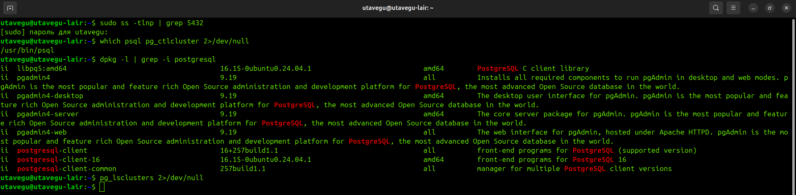
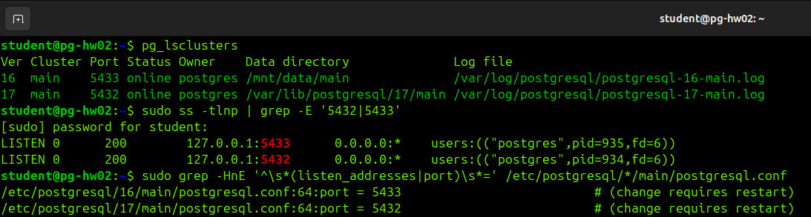
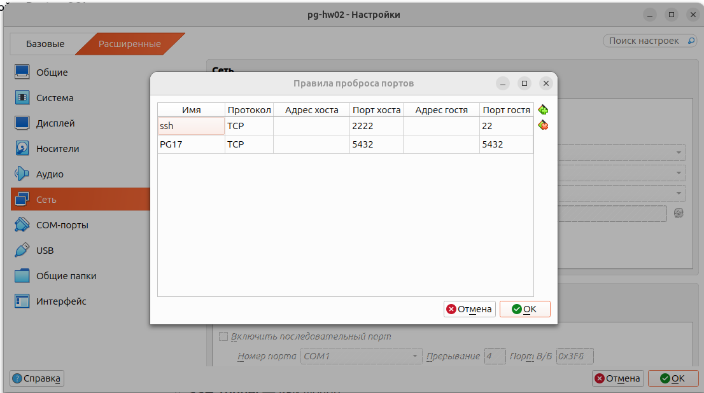
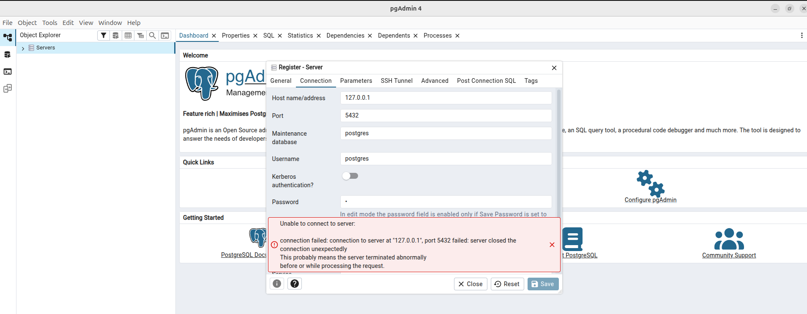
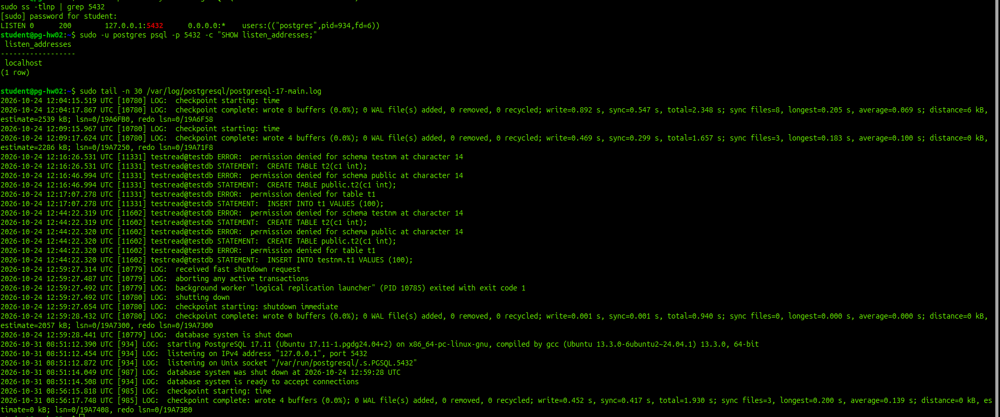
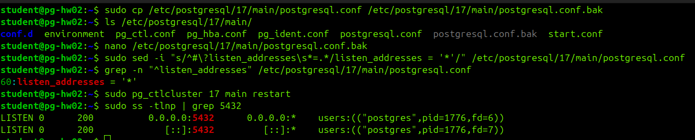
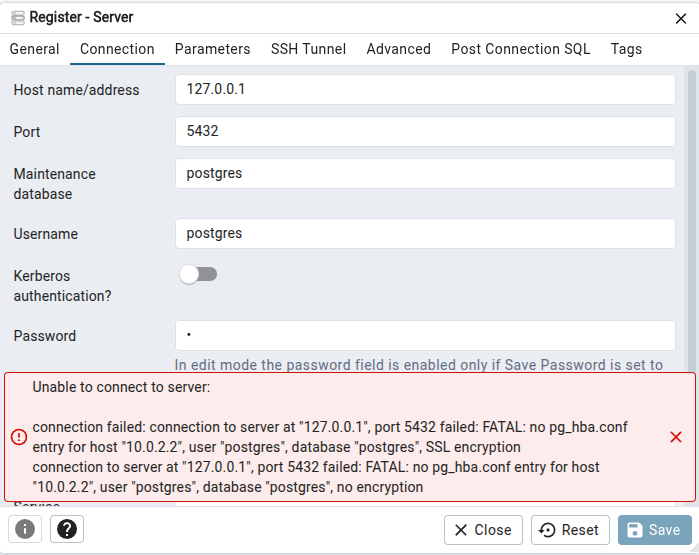
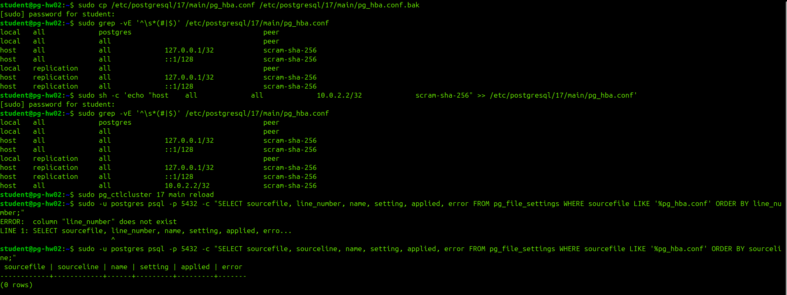
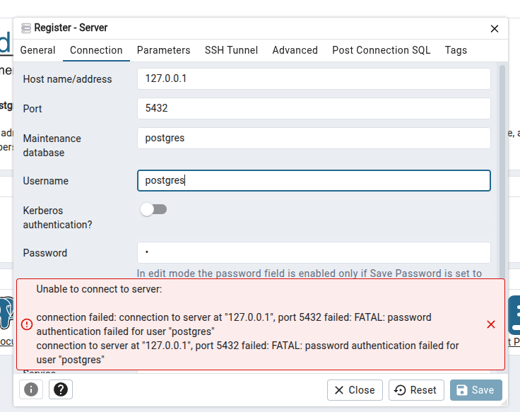
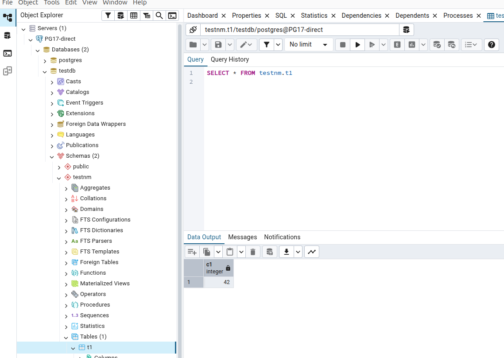

# Установка и настройка доступа через pgAdmin

## Установка pgAdmin

Так как для выполнения этой домашней работы (да и для последующих) мне понадобится pgAdmin за пределами докер-контейнеров, то решил установить его в свою ОС и настроить для работами с базами внутри виртуальной машины.

Устанавливаю ключ репозитория:
```bash
curl -fsS https://www.pgadmin.org/static/packages_pgadmin_org.pub | sudo gpg --dearmor -o /etc/apt/keyrings/packages-pgadmin-org.gpg
```

Добавляю репозиторий:
```bash
sudo sh -c 'echo "deb [signed-by=/etc/apt/keyrings/packages-pgadmin-org.gpg] https://ftp.postgresql.org/pub/pgadmin/pgadmin4/apt/$(lsb_release -cs) pgadmin4 main" > /etc/apt/sources.list.d/pgadmin4.list && apt update'
```

Устанавливаю pgAdmin:
```bash
sudo apt install pgadmin4
```

На своей машине буду подключать его через 5432 порт (так как это стандартный порт для взаимодействия с PostgreSQL), потому сначала проверяю, слушает ли его кто-нибудь (пусто = свободен):
```bash
sudo ss -tlnp | grep 5432
```
(порт свободен)

Установлен ли PostgreSQL (пакеты):
```bash
which psql pg_ctlcluster 2>/dev/null
dpkg -l | grep -i postgresql
```
(локально не установлена, клиентские пакеты есть - конфликтов не будет)

Есть ли локальные кластеры:
```bash
pg_lsclusters 2>/dev/null
```
(кластеров нет)



Затем запускаю виртуальную машину и прежде чем что-то менять, давай зафиксирую текущее состояние.


Какие кластеры есть, на каких портах, запущены ли:
```bash
pg_lsclusters
```

Что реально слушает порты (слушает ли вообще сервер внешний интерфейс или только 127.0.0.1):
```bash
sudo ss -tlnp | grep -E '5432|5433'
```

Текущие listen_addresses и port по каждому кластеру:
```bash
sudo grep -HnE '^\s*(listen_addresses|port)\s*=' /etc/postgresql/*/main/postgresql.conf
```



Далее, чтобы лучше понять материал занятия, буду имитировать различные ошибки

## Имитация первой ошибки (сеть)

Для начала в VirtualBox, в настройках сети виртуальной машины, добавлю новое правило проброса портов:
```
В VirtualBox: Настройки → Сеть → Дополнительно → Проброс портов → «+»:
Имя: PG17
Протокол: TCP
Порт хоста: 5432
Порт гостя: 5432
```


Затем запускаю установленный pgAdmin на хосте и пытаюсь создать профиль подключения в pgAdmin:
```
Register → Server:
Name: PG17-direct
Вкладка Connection: 
	Host: 127.0.0.1
	Port: 5432
	Maintenance DB: postgres
	Username: postgres
	Password: пока любой не важно какой, будеи x.
Вкладка SSH Tunnel — выключена.
Save
```

И получаю первую ошибку подключения:



```
СПРАВКА:
Что делает Register → Server в pgAdmin
Это создание профиля подключения к серверу в твоём локальном pgAdmin. Ты как бы говоришь программе: «запомни адрес, порт, пользователя и способ входа — вот сюда я хочу подключаться». Сам по себе Register не подключается к базе — он только сохраняет настройки. Соединение устанавливается либо сразу (если стоит галочка Connect now?), либо позже, когда ты кликаешь по серверу и выбираешь Connect.
```

Cоединение успело установиться, но PostgreSQL его разорвал уже в процессе. Самая частая причина в учебной среде — сервер принял TCP-соединение, но затем отклонил его на этапе аутентификации, потому что в pg_hba.conf нет подходящего правила для адреса, с которого пришёл клиент.

Через проброс портов VirtualBox (NAT) PostgreSQL на виртуалке видит клиента не как 127.0.0.1, а как адрес NAT-шлюза — обычно 10.0.2.2. А в pg_hba.conf по умолчанию, скорее всего, есть правило только для 127.0.0.1/32. Отсюда и разрыв. Чтобы убедиться в этом, собираю данные:

Что реально слушает PostgreSQL (0.0.0.0 или только 127.0.0.1?):
```bash
sudo ss -tlnp | grep 5432
```
Что сервер думает про listen_addresses (локально через psql):
```bash
sudo -u postgres psql -p 5432 -c "SHOW listen_addresses;"
```
Последние строки лога — там будет точная причина разрыва:
```bash
sudo tail -n 30 /var/log/postgresql/postgresql-17-main.log
```


listen_addresses = 'localhost' → сервер слушает только 127.0.0.1 (это же видно в ss и в логе: listening on IPv4 address "127.0.0.1", port 5432).

В логе нет записи о попытке подключения (типа "no pg_hba.conf entry"). Значит, соединение от pgAdmin до этапа аутентификации вообще не дошло — его оборвал NAT-движок VirtualBox, потому что на адресе 10.0.2.15 (внешний IP гостя в NAT) никто не слушает. Отсюда и странное «server closed the connection unexpectedly» — так NAT иногда маскирует отказ.

Вывод: сейчас проблема не в pg_hba.conf, а в listen_addresses. Это параметр контекста postmaster → нужен restart, а не reload.

## Имитация второй ошибки (listen_addresses)

Правлю listen_addresses:

Бэкап конфига (чтобы можно было откатиться):
```bash
sudo cp /etc/postgresql/17/main/postgresql.conf /etc/postgresql/17/main/postgresql.conf.bak
```

Раскомментирую и ставлю '*' (в продакшене так не делать!):
```bash
sudo sed -i "s/^#\?listen_addresses\s*=.*/listen_addresses = '*'/" /etc/postgresql/17/main/postgresql.conf
```
(заменяю закомментированную строку #listen_addresses = 'localhost' на активную listen_addresses = '*')

Проверяю, что получилось:
```bash
grep -n "^listen_addresses" /etc/postgresql/17/main/postgresql.conf
```

```
СПРАВКА
Если бы я в этот момент подключился к базе и ввёл туда запрос:
SELECT name, setting, pending_restart FROM pg_settings WHERE name = 'listen_addresses';
То флаг pending_restart = true означал бы: «значение в файле изменилось, но пока не применено, нужен restart». После "pg_ctlcluster ... restart" он станет false. Это ровно то, о чём говорилось в слайдах про контекст postmaster.
```

Перезапускаю целевой кластер 17 (не весь systemd-юнит):
```bash
sudo pg_ctlcluster 17 main restart
```
(есть мнение, что надежнее делать не рестарт, а "остановить"->"запустить", но в данном случае согрешу)

Убеждаюсь, что теперь слушаем все интерфейсы:
```bash
sudo ss -tlnp | grep 5432
```


После restart снова пробую подключиться из pgAdmin с теми же настройками. Теперь ожидаю другую ошибку — скорее всего no pg_hba.conf entry for host "10.0.2.2". Это будет означать, что сетевой уровень пройден и попытка упёрлась в уровень аутентификации.



Ошибка — другая

Было: server closed the connection unexpectedly — обрыв на сетевом уровне (NAT не достучался до сервера).

Стало: FATAL: no pg_hba.conf entry for host "10.0.2.2", user "postgres", database "postgres" — сервер принял TCP-соединение, увидел клиента с адреса 10.0.2.2 (это NAT-шлюз VirtualBox) и отказал на уровне аутентификации, потому что в pg_hba.conf нет правила для этого адреса.

То есть listen_addresses + restart сработали как надо (в ss теперь 0.0.0.0:5432 и [::]:5432), и я перехожу к настройке pg_hba.conf. Правки в этом файле можно применить через reload (контекст sighup), без рестарта.

```
СПРАВКА

В `pg_settings` можно увидеть текущие действующие значения, а не те, которые будут после рестарта. Флаг pending_restart = true — это индикатор «файл изменился, но не применён». После рестарта значение изменится на новое и pending_restart станет false.

Чтобы увидеть, какое значение ждёт применения, есть отдельное представление — `pg_file_settings`. У него есть колонки name, setting, applied, error. 

Пример:
sql
SELECT name, setting, applied, error
FROM pg_file_settings
WHERE name = 'listen_addresses';

Здесь setting — то, что прочитано из файла (новое значение), а applied = false означало бы «ещё не применено». После рестарта applied станет true.
```

```sql
--- pg_settings — текущие действующие значения:

sql
SELECT name, setting, unit, context, pending_restart, source
FROM pg_settings
ORDER BY name;

--- Полезные фильтры:

sql
-- Только параметры, требующие restart
SELECT name, setting, context, pending_restart
FROM pg_settings
WHERE pending_restart = true;

-- Параметры с контекстом postmaster (потенциально требуют restart)
SELECT name, setting, context
FROM pg_settings
WHERE context = 'postmaster';

--- pg_file_settings — что написано в файлах (и применилось ли):

sql
SELECT sourcefile, sourceline, name, setting, applied, error
FROM pg_file_settings
ORDER BY sourcefile, seqno;
```

## Имитация третьей ошибки (пароль/роль)

Правим pg_hba.conf и делаем reload.

```
СПРАВКА:
Что означает hba в pg_hba.conf
HBA = Host-Based Authentication — «аутентификация по имени узла» (хоста). То есть PostgreSQL смотрит, с какого адреса пришёл клиент, и в зависимости от этого решает, пускать его или нет и как проверять пароль. Это не про конкретного пользователя, а про сетевой источник подключения. Отсюда и название файла: pg_hba.conf — конфигурация host-based аутентификации.
```

Сначала бэкап:
```bash
sudo cp /etc/postgresql/17/main/pg_hba.conf /etc/postgresql/17/main/pg_hba.conf.bak
```

Смотрю текущие правила и их порядок:
```bash
sudo grep -vE '^\s*(#|$)' /etc/postgresql/17/main/pg_hba.conf
```

Добавляю правило для 10.0.2.2/32. Дописываю строку в конец pg_hba.conf. Порядок важен (первое совпадение выигрывает), но 10.0.2.2 не пересекается с существующими 127.0.0.1/32 и ::1/128, так что конец файла — безопасно.
```bash
sudo sh -c 'echo "host    all             all             10.0.2.2/32             scram-sha-256" >> /etc/postgresql/17/main/pg_hba.conf'
```

Проверяю, что строка на месте и синтаксис не сломан:
```bash
sudo grep -vE '^\s*(#|$)' /etc/postgresql/17/main/pg_hba.conf
```

Применяю изменения без разрыва соединений (reload, а не restart, так как контекст sighup):
```bash
sudo pg_ctlcluster 17 main reload
```

Вызываю представление pg_file_settings, чтобы убедиться, что новая строка применилась (applied = true, error = NULL).
```bash
sudo -u postgres psql -p 5432 -c "SELECT sourcefile, line_number, name, setting, applied, error FROM pg_file_settings WHERE sourcefile LIKE '%pg_hba.conf' ORDER BY line_number;"
```

Но ловлю ошибку, так как надо было имя колонки sourceline, а не line_number. Правлю запрос:
```bash
sudo -u postgres psql -p 5432 -c "SELECT sourcefile, sourceline, name, setting, applied, error FROM pg_file_settings WHERE sourcefile LIKE '%pg_hba.conf' ORDER BY sourceline;"
```



Результат снова не соответствует ожиданиям. Но вообще для pg_hba.conf это представление не очень показательно: оно в основном про параметры из postgresql.conf. Для pg_hba.conf проще проверить, что файл прочитан без ошибок, — в логе при reload не должно быть строк ERROR/FATAL.

```bash
sudo tail -n 5 /var/log/postgresql/postgresql-17-main.log
```

pg_file_settings показывает только параметры GUC (то, что из postgresql.conf, postgresql.auto.conf, conf.d/*.conf). Строки из pg_hba.conf — это не GUC, у них другой механизм загрузки, и в pg_file_settings их не видно. Так что 0 rows здесь — ожидаемо, а не ошибка.

Снова иду в pgAdmin, чтобы поймать теперь уже третью ошибку: password authentication failed for user "postgres" (если пароль неверный/не задан) — либо успешное подключение.



Ошибка благополучно поймана и остались финальные штрихи для успешного подключения.

## Финишная прямая

Почему password authentication failed? Правило 10.0.2.2/32 scram-sha-256 нашлось (иначе была бы предыдущая ошибка no pg_hba.conf entry). Значит, сервер дошёл до проверки пароля и она не прошла. Причин обычно две:
- В pgAdmin введён неверный пароль (или поле пустое).
- У роли postgres вообще не задан пароль, либо он захеширован под md5, а правило требует scram-sha-256.

Сначала диагностика.

Смотрю, есть ли у роли postgres пароль и в каком формате хеш (SCRAM-SHA-256 или md5):
```bash
sudo -u postgres psql -p 5432 -c "SELECT rolname, substr(rolpassword,1,14) AS hash_prefix FROM pg_authid WHERE rolname='postgres';"
```
- если hash_prefix = SCRAM-SHA-256$ → пароль под scram, ок;
- если md5 + 32 символа → пароль под md5, надо перезадать (или сменить метод в pg_hba на md5);
- если NULL → пароля нет, надо задать.

Задаю пароль роли postgres — под текущий метод scram-sha-256. Указываю его тут, так как это учебная база внутри моей виртуально машины, но на проде так делать нельзя!
```bash
sudo -u postgres psql -p 5432 -c "ALTER ROLE postgres PASSWORD 'postgres';"
```

После этого снова пробую подключиться из pgAdmin с паролем "postgres". В это раз попытка успешна и я вижу тестовые базу, схему и таблицу из предыдущего домашнего задания:


Таким образом, в рамках этого исследования я на практике закрепил материал с лекции, а заодно и настроил подключение pgAdmin-а для выполнения дальнейших учебных заданий.