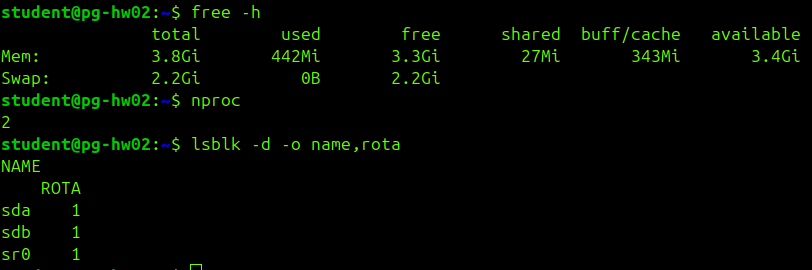
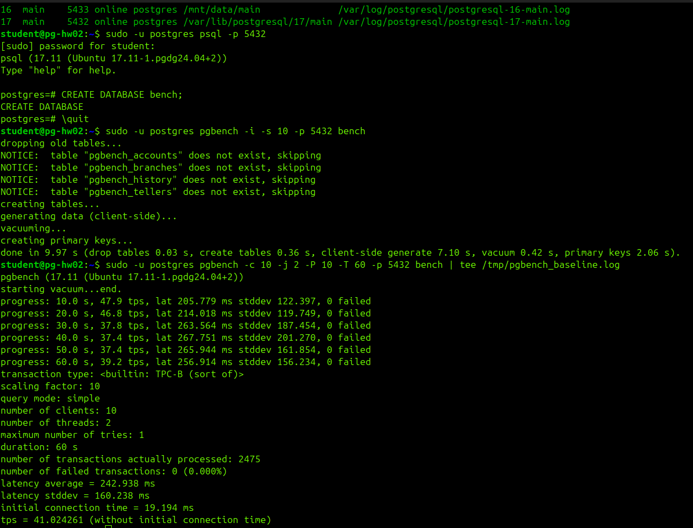
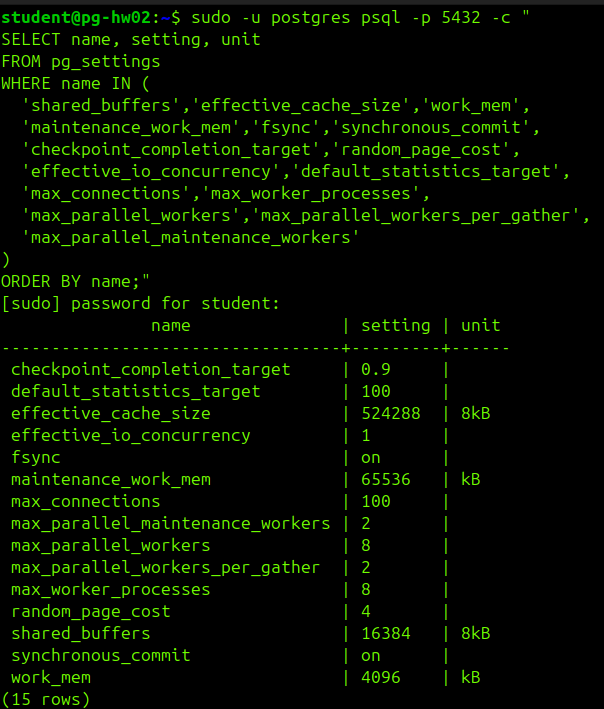
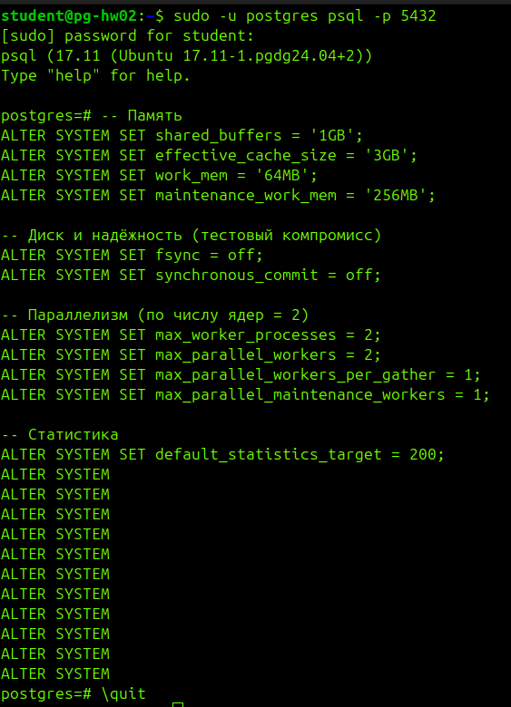
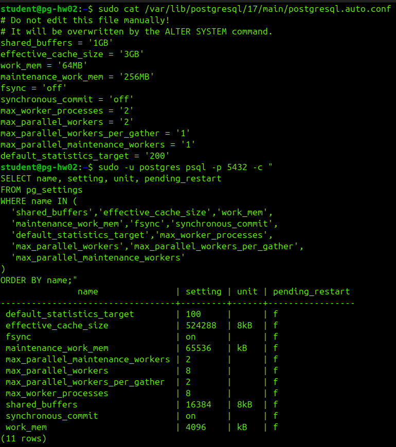
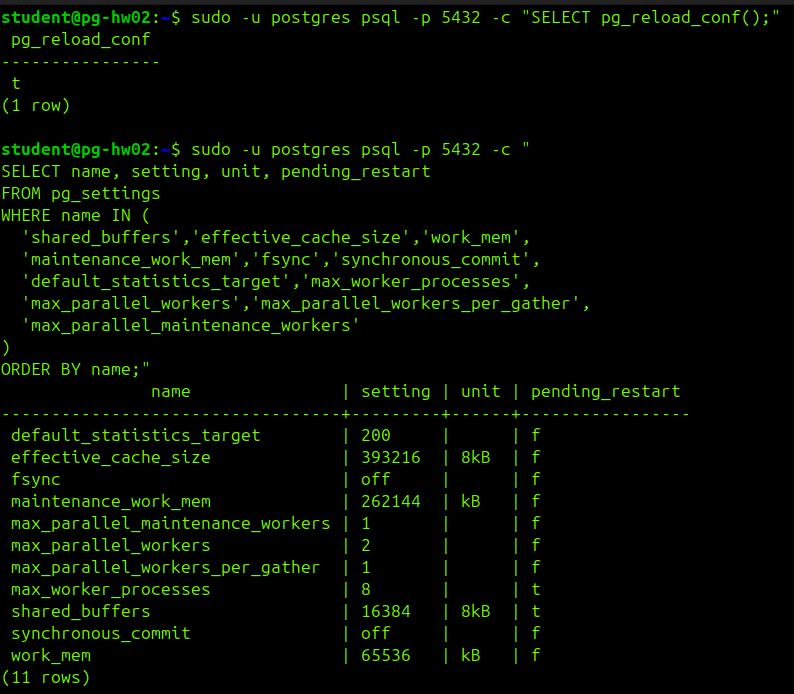
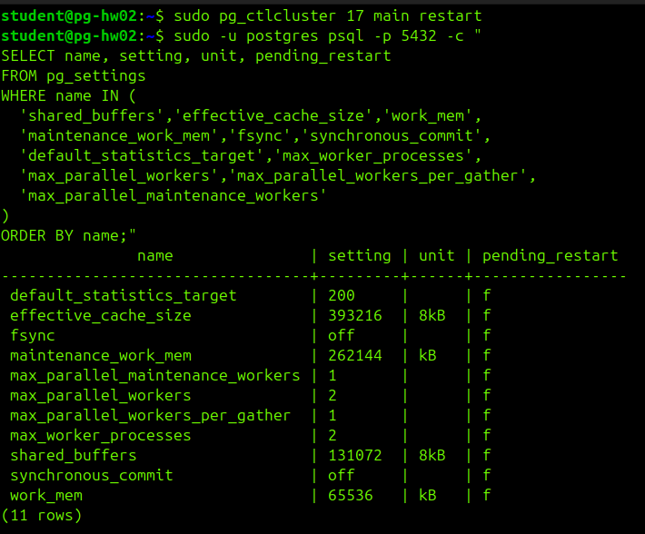
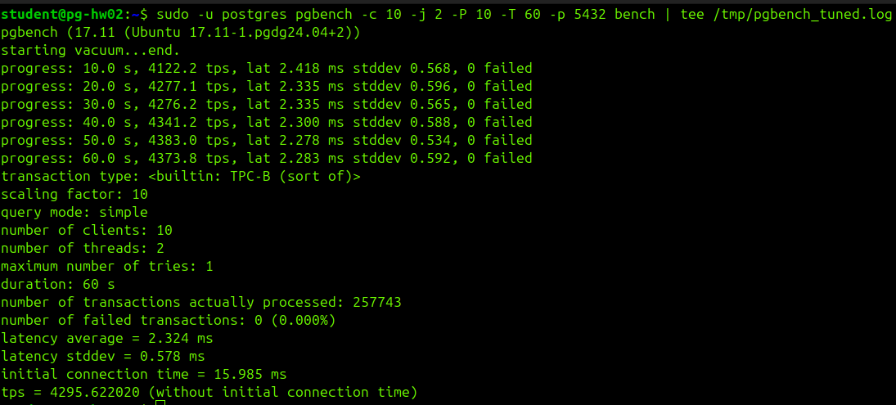

# Домашнее задание блока "Настройка PostgreSQL"

## Сбор данных о железе

Фундамент для любого тюнинга - познакомиться с параметрами железа, на котором размещена база. Без них невозможно осмысленно выбрать значения `shared_buffers`, `work_mem` и других параметров.

Узнаю объём оперативной памяти (RAM):
```bash
free -h
```
Общий объём RAM (например, total в строке "Mem:") - это ключевая цифра для расчёта параметров памяти.

Узнаю количество ядер CPU:
```bash
nproc
```
Это число понадобится для настройки параметров параллелизма.

Определяю тип диска (SSD или HDD):
```bash
lsblk -d -o name,rota
```
Если в колонке ROTA стоит 1, это HDD, если 0 — SSD (или другое энергонезависимое устройство). Это повлияет на параметр `random_page_cost`.



## Инициализация тестовой базы данных pgbench

Создам базу данных и наполню её тестовыми таблицами.

Подключаюсь к PostgreSQL под суперпользователем:
```
sudo -u postgres psql -p 5432
```

Создаю базу данных для тестов:
```
CREATE DATABASE bench;
\quit
```

Инициализация pgbench в 17 кластере:
```
sudo -u postgres pgbench -i -s 10 -p 5432 bench
```
`-p 5432` — ключевой флаг, без него pgbench пойдёт на дефолтный порт (у меня он тоже 5432, но лучше явно).

Разбор:
- `sudo -u postgres`	выполняет команду от имени системного пользователя postgres (у него есть права суперпользователя в PostgreSQL)
- `pgbench`	утилита нагрузочного тестирования, поставляется вместе с PostgreSQL
- `-i`	(initialize) — режим инициализации: создать 4 таблицы и наполнить их данными
- `-s 10`	(scale) — масштаб. -s 1 = 100 000 строк в pgbench_accounts, -s 10 = 1 000 000 строк. Соответственно растут и pgbench_branches (10 строк), pgbench_tellers (100 строк)
- `-p 5432`	(port) — к какому кластеру подключаться. У меня 16-й на 5433, 17-й на 5432 → идём в 17-й
- `bench`	имя базы данных, в которой работаем

### Что произошло по выводу:

- `dropping old tables... + NOTICE ... does not exist, skipping` — pgbench пытается удалить старые тестовые таблицы, но их не было (первый запуск). Это нормально.

- `creating tables...` — созданы 4 таблицы: pgbench_accounts, pgbench_branches, pgbench_tellers, pgbench_history.

- `generating data (client-side)...` — данные сгенерированы на клиенте и залиты в БД (в данном случае «клиент» = тот же процесс pgbench, но генерация идёт в его памяти).

- `vacuuming... + creating primary keys...` — pgbench после заливки делает VACUUM и создаёт первичные ключи.

- `done in 9.97 s` — общее время инициализации.

### Прогон pgbench:

```
sudo -u postgres pgbench -c 10 -j 2 -P 10 -T 60 -p 5432 bench | tee /tmp/pgbench_baseline.log
```
Внимание: -j 2 (по числу ядер), а не -j 4.

Разбор:
- `-c 10`	(clients) — 10 одновременных клиентских сессий (имитируют 10 пользователей, каждый шлёт транзакции в цикле)
- `-j 2`	(jobs) — 2 рабочих потока pgbench. Клиенты распределяются между потоками. Мы поставили 2 = числу ядер CPU
- `-P 10`	(progress) — каждые 10 секунд выводить промежуточный отчёт (TPS и латентность)
- `-T 60`	(time) — длительность теста 60 секунд (взаимоисключающе с -t N — число транзакций на клиента)
- `-p 5432`	(port) - порт 17-го кластера
- `bench` -	база данных
- | tee /tmp/pgbench_baseline.log	tee дублирует вывод: и на экран, и в файл /tmp/pgbench_baseline.log — для отчёта

Внимание: не путать -p и -P - это разные флаги!

### Что означают цифры в выводе

Прогресс-строки:

```text
progress: 10.0 s, 47.9 tps, lat 205.779 ms stddev 122.397, 0 failed
10.0 s — прошло 10 секунд с начала.

47.9 tps — TPS за последние 10 секунд (не накопительно).

lat 205.779 ms stddev 122.397 — средняя латентность транзакции и её стандартное отклонение.

0 failed — сколько транзакций упало с ошибкой (у нас 0 — отлично).
```

Итоговая часть:

```text
transaction type: <builtin: TPC-B (sort of)>
```
TPC-B — стандартный синтетический бенчмарк из 5 команд: UPDATE accounts, SELECT accounts, UPDATE tellers, UPDATE branches, INSERT history. «sort of» — потому что pgbench не строго соответствует стандарту TPC-B.

```text
scaling factor: 10
```
Масштаб, с которым проинициализирована БД (1 млн строк).

```text
number of clients: 10
number of threads: 2
duration: 60 s
```

### Параметры прогона.

```text
number of transactions actually processed: 2475
```
Всего выполнено 2475 транзакций за 60 с.

```text
number of failed transactions: 0 (0.000%)
```
Ошибок нет.

```text
latency average = 242.938 ms
latency stddev = 160.238 ms
```
Средняя латентность ≈ 243 мс — это очень много для OLTP. Отсюда и низкий TPS.

```text
initial connection time = 19.194 ms
```
Время установки соединений (не учитывается в TPS).

```text
tps = 41.024261 (without initial connection time)
```
Главная цифра: ≈ 41 TPS. Это и есть baseline.

### Что уже видно из результата
Динамика по времени: в первые 20 сек TPS был ~47–48, потом упал до ~37–39. Это классический эффект checkpoint: PostgreSQL раз в ~5 минут делает контрольную точку, сбрасывает «грязные» страницы на диск, и в это время I/O-нагрузка резко растёт. Скорее всего, попадание в checkpoint как раз и дало «просадку». Это одна из причин, почему checkpoint_completion_target и fsync/synchronous_commit так сильно влияют.

Латентность 243 мс — это очень медленно. Типичный OLTP-сервер должен выдавать единицы мс. Причина — медленный диск ВМ + дефолтные настройки (sync-write на каждый коммит).

41 TPS — это «пол» для такого стенда. После тюнинга ожидаем увидеть в разы больше (особенно за счёт fsync = off).



Посмотрим текущие значения ключевых параметров, чтобы в отчёте корректно заполнить колонку «Было».
```
sudo -u postgres psql -p 5432 -c "
SELECT name, setting, unit
FROM pg_settings
WHERE name IN (
  'shared_buffers','effective_cache_size','work_mem',
  'maintenance_work_mem','fsync','synchronous_commit',
  'checkpoint_completion_target','random_page_cost',
  'effective_io_concurrency','default_statistics_target',
  'max_connections','max_worker_processes',
  'max_parallel_workers','max_parallel_workers_per_gather',
  'max_parallel_maintenance_workers'
)
ORDER BY name;"

[sudo] password for student: 

               name               | setting | unit 
----------------------------------+---------+------
 checkpoint_completion_target     | 0.9     | 
 default_statistics_target        | 100     | 
 effective_cache_size             | 524288  | 8kB
 effective_io_concurrency         | 1       | 
 fsync                            | on      | 
 maintenance_work_mem             | 65536   | kB
 max_connections                  | 100     | 
 max_parallel_maintenance_workers | 2       | 
 max_parallel_workers             | 8       | 
 max_parallel_workers_per_gather  | 2       | 
 max_worker_processes             | 8       | 
 random_page_cost                 | 4       | 
 shared_buffers                   | 16384   | 8kB
 synchronous_commit               | on      | 
 work_mem                         | 4096    | kB
(15 rows)
```



## Разбор вывода pg_settings

Важный момент: pg_settings.setting показывает значение в базовых единицах, а не в тех, что я вводил. Например:

| Параметр | setting | unit  | Реально это
| --- | --- | --- | --- |
| shared_buffers  | 16384 | 8kB | 16384 × 8 kB = 128 MB
| effective_cache_size  | 524288 | 8kB | 524288 × 8 kB = 4 GB
| work_mem  | 4096 | kB | 4 MB
| maintenance_work_mem  | 65536 | kB | 64 MB
			
Это дефолты PostgreSQL. Ими и заполним колонку «Было» в отчёте.

### Комментарий по остальным:

- max_worker_processes = 8, max_parallel_workers = 8 — для 2-ядерной ВМ это избыточно, но не вредно. Оптимизация «на будущее»: уменьшить до 2 — но на TPC-B это не повлияет (там нет параллельных запросов).

- fsync = on, synchronous_commit = on — вот здесь и спрятан главный тормоз.

- random_page_cost = 4, effective_io_concurrency = 1 — оставляем.

## Следующий шаг: применить изменения через ALTER SYSTEM

ALTER SYSTEM не трогает postgresql.conf — он пишет в postgresql.auto.conf, который читается последним и поэтому перекрывает основной файл. Это безопасный способ: если что-то пойдёт не так, ALTER SYSTEM RESET вернёт дефолт.

1. Подключаюсь к 17-му кластеру:
```bash
sudo -u postgres psql -p 5432
```

2. Внутри psql выполняю изменения:
```sql
-- Память
ALTER SYSTEM SET shared_buffers = '1GB';
ALTER SYSTEM SET effective_cache_size = '3GB';
ALTER SYSTEM SET work_mem = '64MB';
ALTER SYSTEM SET maintenance_work_mem = '256MB';

-- Диск и надёжность (тестовый компромисс)
ALTER SYSTEM SET fsync = off;
ALTER SYSTEM SET synchronous_commit = off;

-- Параллелизм (по числу ядер = 2)
ALTER SYSTEM SET max_worker_processes = 2;
ALTER SYSTEM SET max_parallel_workers = 2;
ALTER SYSTEM SET max_parallel_workers_per_gather = 1;
ALTER SYSTEM SET max_parallel_maintenance_workers = 1;

-- Статистика
ALTER SYSTEM SET default_statistics_target = 200;
```
3. Выхожу из psql:

```text
\quit
```



### Что делает каждая команда и зачем

| Параметр | Было → Стало | Зачем
| --- | --- | --- |
| shared_buffers  | 128 MB → 1 GB | Основной кеш данных. ~25% RAM. Больше данных кешируется → меньше чтений с диска.
| effective_cache_size  | 4 GB → 3 GB	 | «Подсказка» планировщику, сколько всего ОС держит в кеше. ~75% RAM. Влияет на выбор плана (index scan vs seq scan).
| work_mem  | 4 MB → 64 MB | Память на одну операцию сортировки/хеширования. На TPC-B не влияет (там нет сортировок), но пригодится для других запросов.
| maintenance_work_mem  | 64 MB → 256 MB | Для VACUUM, CREATE INDEX и т.п. На сам прогон не влияет, но ускорит VACUUM, который делает pgbench в конце.
| fsync  | on → off | Главное изменение для TPS. Сервер перестаёт звать fsync() для сброса WAL на диск. В тестовой среде допустимо, в проде — категорически нет (потеря данных при сбое).
| synchronous_commit  | on → off | Второе главное изменение. Клиент получает подтверждение коммита, не дожидаясь фактической записи WAL на диск. Огромный прирост TPS на медленных дисках.
| max_worker_processes  | 8 → 2 | По числу ядер. Убираем потенциальный overcommit.
| max_parallel_workers  | 8 → 2 | То же.
| max_parallel_workers_per_gather  | 2 → 1 | Один worker на запрос — достаточно для 2-ядерной ВМ.
| max_parallel_maintenance_workers  | 2 → 1	 | То же для служебных операций.
| default_statistics_target  | 100 → 200 | Точнее статистика. На TPC-B не влияет, но полезно в целом.

### Что важно понимать про ожидаемый результат
Из всех изменений реально на TPS в pgbench повлияют только два:

1) fsync = off + synchronous_commit = off — главный эффект, в разы.

2) shared_buffers = 1GB — умеренный эффект, меньше чтений с диска.

Те два параметра, о которых говорил преподаватель, — это именно fsync и synchronous_commit. Оба управляют синхронной записью на диск:

- fsync = off — PostgreSQL перестаёт вызывать системный fsync() для принудительного сброса изменённых страниц / WAL на физический носитель. Пишет в кеш ОС и идёт дальше.

- synchronous_commit = off — клиент получает подтверждение COMMIT до того, как WAL гарантированно попал на диск. Транзакция «зафиксирована» логически, но физически может ещё висеть в кеше.

На проде это означает: при сбое питания / падении ОС можно потерять последние несколько секунд (или миллисекунд) закоммиченных транзакций. Для банка — недопустимо. Для нагрузочного теста — идеально, потому что убирает главное узкое место.

Остальные — «для полноты картины»: work_mem, max_parallel_*, default_statistics_target на TPC-B не влияют, потому что там нет сортировок, параллельных планов и сложной статистики.

## Проверка после внесения изменений

После выполнения ALTER SYSTEM-команд и выхода из psql, пока не перезапускаю кластер. Сначала посмотрю, что реально попало в postgresql.auto.conf и что об этом говорит pg_settings.pending_restart. По выводам этих команд будет понятно, что все изменения приняты и какие из них требуют restart (pending_restart = t).

```bash
sudo cat /var/lib/postgresql/17/main/postgresql.auto.conf

sudo -u postgres psql -p 5432 -c "
SELECT name, setting, unit, pending_restart
FROM pg_settings
WHERE name IN (
  'shared_buffers','effective_cache_size','work_mem',
  'maintenance_work_mem','fsync','synchronous_commit',
  'default_statistics_target','max_worker_processes',
  'max_parallel_workers','max_parallel_workers_per_gather',
  'max_parallel_maintenance_workers'
)
ORDER BY name;"
```



## Почему pg_settings показывает старые значения?

postgresql.auto.conf на диске уже с новыми значениями — это видно через cat. Но запущенный сервер этот файл ещё не перечитал. PostgreSQL читает конфиг:

- при старте (pg_ctlcluster 17 main start),

- при явном reload (SELECT pg_reload_conf() или pg_ctl reload),

- при restart (stop + start).

Между этими событиями сервер держит в памяти ту версию конфига, которую прочитал при последнем старте/reload. Поэтому pg_settings показывает старые значения — это не «сервер не видит файл», а «сервер файл ещё не перечитывал».

И вот почему pending_restart = f у всех:
pending_restart становится t только после reload, если параметр нельзя применить «на лету» и нужен рестарт. Пока reload не было — сервер вообще не знает, что файл изменился, поэтому и флаг не выставлен. Это логично: pending_restart — это не «файл отличается от запущенного», а «я перечитал файл, увидел новое значение, но применить не могу без рестарта».

## Reload vs Restart — в чём разница

У нас в списке изменений есть параметры контекста postmaster — как минимум shared_buffers и max_worker_processes. Для них reload недостаточно, нужен restart. Но полезно сначала сделать reload и увидеть разницу глазами: часть параметров применится сразу, а «тяжёлые» помечатся pending_restart = t. Это позволит на практике увидеть, о чём была лекция.

| Критерий  | Reload (pg_reload_conf()) | Restart (pg_ctlcluster ... restart)
| --- | --- | --- |
| Что делает  | Перечитывает конфиг-файлы | Полностью останавливает и запускает сервер
| Кому хватает  | Параметрам контекста sighup, user, backend | Всем, включая postmaster
| Простой сервиса  | Нет, соединения не рвутся | Да, все соединения обрываются
| Скорость  | Мгновенно | Секунды

## Следующий шаг: reload и проверка «что применилось, что ждёт рестарта»
1. Делаю reload:
```bash
sudo -u postgres psql -p 5432 -c "SELECT pg_reload_conf();"
```

2. Сразу после этого повторяю запрос к pg_settings:
```bash
sudo -u postgres psql -p 5432 -c "
SELECT name, setting, unit, pending_restart
FROM pg_settings
WHERE name IN (
  'shared_buffers','effective_cache_size','work_mem',
  'maintenance_work_mem','fsync','synchronous_commit',
  'default_statistics_target','max_worker_processes',
  'max_parallel_workers','max_parallel_workers_per_gather',
  'max_parallel_maintenance_workers'
)
ORDER BY name;"
```

Ожидаю увидеть:

- fsync, synchronous_commit, work_mem, effective_cache_size, default_statistics_target, max_parallel_workers_per_gather, max_parallel_maintenance_workers — новые значения, pending_restart = f (применились на лету).

- shared_buffers, max_worker_processes, max_parallel_workers, maintenance_work_mem — старые значения, pending_restart = t (ждут рестарта).



### Применилось сразу после reload (pending_restart = f)

| Параметр  | Стало | Комментарий
| --- | --- | --- |
| fsync  | off | контекст sighup — читается из файла на лету
| synchronous_commit  | off | контекст user/sighup — применяется к новым транзакциям
| work_mem  | 65536 kB = 64 MB | контекст user — на лету
| effective_cache_size  | 393216 × 8kB = 3 | контекст user — на лету
| default_statistics_target  | 200 | контекст user — на лету
| max_parallel_workers_per_gather  | 1 | контекст user — на лету
| max_parallel_maintenance_workers  | 1 | контекст user — на лету
| max_parallel_workers  | 2 | применилось на reload — хотя ожидался postmaster. Приятная неожиданность.
| maintenance_work_mem  | 262144 kB = 256 MB | тоже применилось на reload — я ошибся в прогнозе, у этого параметра контекст sighup, а не postmaster.

### Ждут рестарта (pending_restart = t)

| Параметр  | Стало в файле | Сейчас в памяти | Почему
| --- | --- | --- | --- |
| shared_buffers  | 1GB | 16384 × 8kB = 128 MB | контекст postmaster — размер разделяемой памяти фиксируется при старте процесса postmaster, на лету не перераспределить
| max_worker_processes  | 2 | 8 | контекст postmaster — пул фоновых процессов создаётся при старте

### Что это даёт для отчёта
Это готовый практический вывод: «reload применил большинство параметров, но два (shared_buffers, max_worker_processes) потребовали restart — именно они имеют контекст postmaster и затрагивают структуру разделяемой памяти / пул процессов».

## restart 17-го кластера и проверка

1. Перезапускаю 17-й кластер:
```bash
sudo pg_ctlcluster 17 main restart
```
17 main — версия и имя кластера. 16-й на 5433 не тронется. restart = stop + start.

2. Проверяю:
```bash
sudo -u postgres psql -p 5432 -c "
SELECT name, setting, unit, pending_restart
FROM pg_settings
WHERE name IN (
  'shared_buffers','effective_cache_size','work_mem',
  'maintenance_work_mem','fsync','synchronous_commit',
  'default_statistics_target','max_worker_processes',
  'max_parallel_workers','max_parallel_workers_per_gather',
  'max_parallel_maintenance_workers'
)
ORDER BY name;"
```
Ожидаю, что у всех pending_restart = f, а shared_buffers показывает 131072 (это 131072 × 8kB = 1 GB) и max_worker_processes = 2.



### Рестарт прошёл чисто

pending_restart = f у всех — значит, запущенный сервер и файл конфигурации полностью согласованы. Это идеальное состояние для повторного теста: мы точно знаем, что сравниваем baseline (дефолты) с тюнингом, а не с промежуточным состоянием.

| Параметр  | setting | В привычных единицах
| --- | --- | --- |
| shared_buffers  | 131072 × 8kB | 1 GB ✅
| effective_cache_size  | 393216 × 8kB | 3 GB ✅
| work_mem  | 65536 kB | 64 MB ✅
| maintenance_work_mem  | 262144 kB | 256 MB ✅
| max_worker_processes  | 2 | ✅
| max_parallel_workers  | 2 | ✅
| max_parallel_workers_per_gather  | 1 | ✅
| max_parallel_maintenance_workers  | 1 | ✅
| default_statistics_target  | 200 | ✅
| fsync  | off | ✅
| synchronous_commit  | off | ✅

## Повторный прогон pgbench
Важно: параметры прогона должны быть точно такими же, как в baseline, иначе сравнение будет некорректным.

Baseline был:
```text
sudo -u postgres pgbench -c 10 -j 2 -P 10 -T 60 -p 5432 bench
```

Повторяю ровно то же самое, но результат пишу уже в другой лог-файл:
```bash
sudo -u postgres pgbench -c 10 -j 2 -P 10 -T 60 -p 5432 bench | tee /tmp/pgbench_tuned.log
```

### Почему именно так:
- `-c 10 -j 2 -T 60` — те же клиенты, потоки, длительность. Любое изменение сломало бы сравнимость.

- `-P 10` — прогресс каждые 10 секунд, удобно смотреть динамику.

- `tee /tmp/pgbench_tuned.log` — сохраняю вывод в отдельный файл, чтобы приложить к отчёту рядом с baseline-логом.

### Что смотреть в выводе:

- `tps = ...` в самом конце — главная цифра для сравнения.

- Прогресс-строки — интересно, будет ли просадка к концу (как в baseline, где TPS упал с ~48 до ~37). Если fsync=off убрал эффект checkpoint, кривая должна быть ровнее.

- `latency average` — должна упасть в разы. В baseline было ~243 мс — это очень много.

- `number of transactions actually processed` — должно вырасти пропорционально TPS.



## Результаты оптимизации

Что важно заметить в прогресс-строках
Baseline: TPS падал по ходу теста: 47.9 → 46.8 → 37.8 → 37.4 → 37.4 → 39.2. Классический эффект checkpoint — на пике сброса грязных страниц I/O захлёбывался.

| Метрика  | Baseline | После тюнинга | Изменение
| --- | --- | --- | --- |
| TPS  | 41.02 | 4295.62 | ×104.7 (+10370%)
| Latency average  | 242.9 ms | 2.32 ms | ×0.0096 (в ~105 раз меньше)
| Transactions processed  | 2 475 | 257 743 | ×104
| Failed transactions  | 0 | 0 | —
| stddev латентности  | 160 ms | 0.58 ms | стабильность выросла в ~275 раз

После тюнинга: TPS ровный и даже слегка растёт: 4122 → 4277 → 4276 → 4341 → 4383 → 4373. Просадки нет вообще — потому что fsync = off убрал синхронный сброс на диск, а checkpoint_completion_target = 0.9 (он и так был дефолтом, но теперь работает «в полную силу») сглаживает пики.

### Какие параметры дали эффект — честный разбор

- `fsync = off + synchronous_commit = off`— ~95–99% прироста. Это видно по латентности: 243 мс → 2.3 мс. В baseline каждый коммит ждал fsync() на медленном виртуальном SATA-диске — отсюда ~240 мс. С отключением синхронной записи ожидание исчезло.

- `shared_buffers 128 MB → 1 GB` — небольшой вклад (единицы процентов). На 1 млн строк scale=10 и 10 клиентах рабочий набор помещается в 128 MB, так что прирост от кеша скромный. Но он есть.

- `work_mem, default_statistics_target, max_parallel_*` — в TPC-B не участвуют. В TPC-B нет сортировок, нет сложной статистики, нет параллельных планов. Поэтому эти изменения на результат не повлияли — это важно честно написать в отчёте, а не приписывать им эффект.

- `random_page_cost и effective_io_concurrency` — не менял (тип диска неизвестен), и правильно: на TPC-B они почти не влияют.

### Итоговая мысль для отчёта

Прирост в ~105 раз достигнут почти исключительно за счёт отключения синхронной записи (fsync, synchronous_commit). Это доказывает, что узким местом в baseline была именно дисковая подсистема виртуальной машины. В продакшене такое отключение недопустимо из-за риска потери данных при сбое — прирост этот является «синтетическим» и показывает верхнюю границу эффекта от устранения I/O-бутылочного горлышка.

Короткое резюме того, что в итоге получилось:

- Baseline: 41.02 TPS, латентность ~243 мс, с заметной просадкой к концу прогона из-за checkpoint.

- После тюнинга: 4295.62 TPS, латентность ~2.3 мс, ровный график без просадок.

- Прирост: ×104.7 (+10370%), достигнут практически целиком за счёт fsync = off + synchronous_commit = off — то есть устранения ожидания синхронной записи на медленный виртуальный SATA-диск.

Побочный, но важный вывод: reload применил большинство параметров на лету, а shared_buffers и max_worker_processes (контекст postmaster) потребовали restart — это хороший практический пример к разделу про контексты.

Честная оговорка: work_mem, default_statistics_target, max_parallel_* в TPC-B не участвуют, поэтому на TPS не повлияли — это «задел на будущее», а не как источник прироста.

Такой большой прирос обусловлен тем, что прирост синтетический: отключение синхронной записи показывает верхнюю границу эффекта от снятия I/O-бутылочного горлышка, и в проде так делать нельзя из-за риска потери закоммиченных транзакций при сбое.

ПС: я сохранял файлы отчёта в директорию /tmp на виртуальной машине и они не пережили её перезапуск. Не ок, но благо я все данные тестирования "до" и "после" успел сохранить в этот отчёт и сделать скриншоты прогонов.